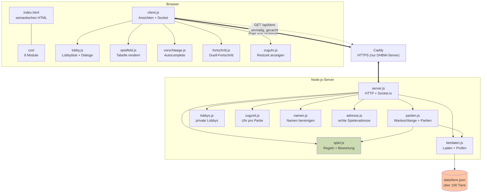
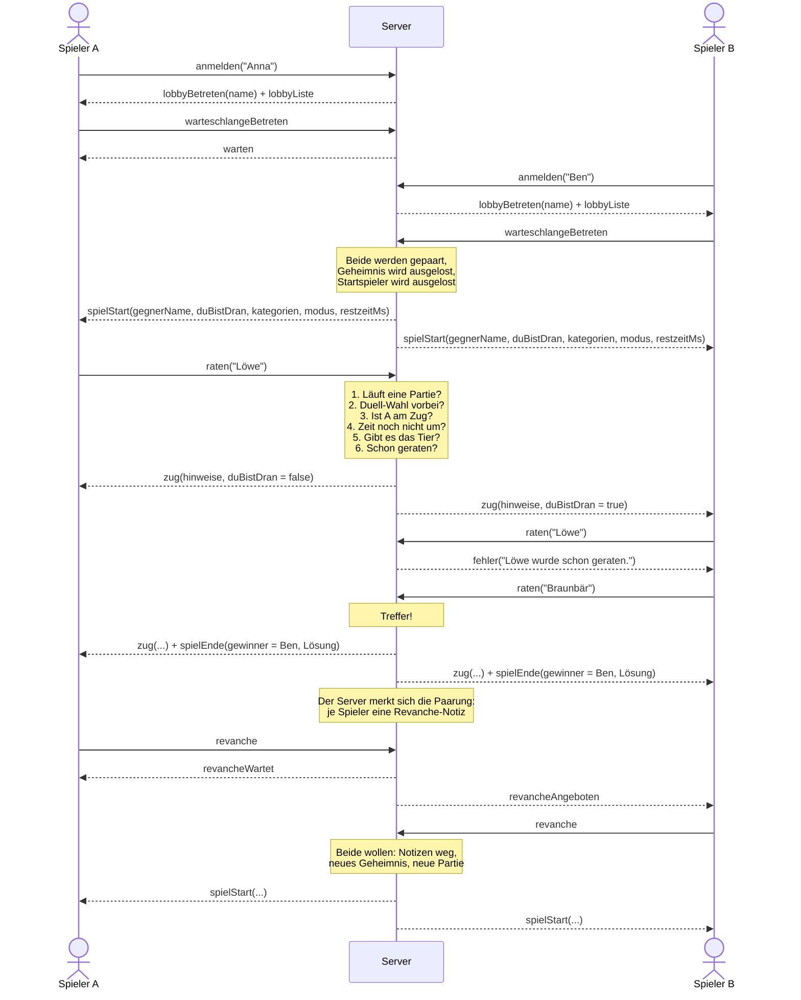
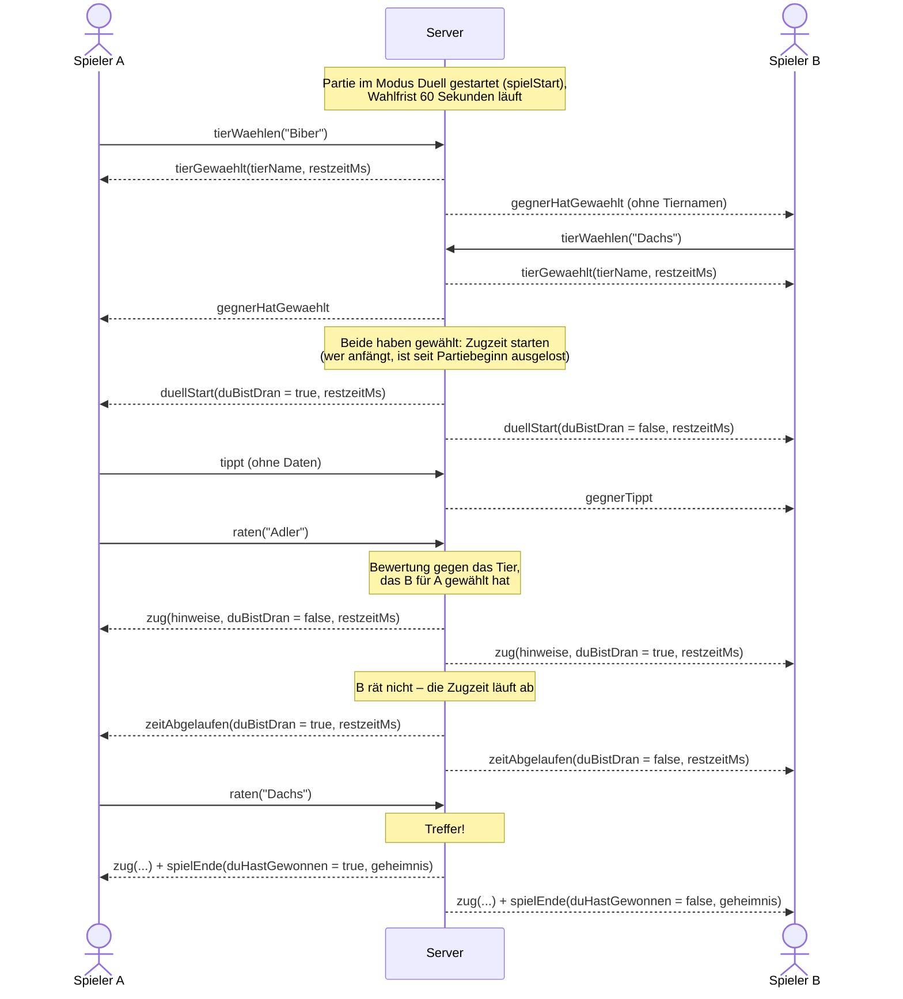
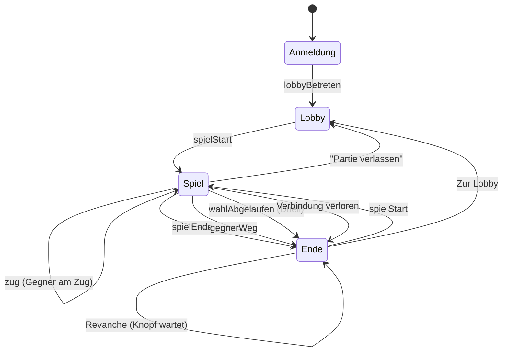
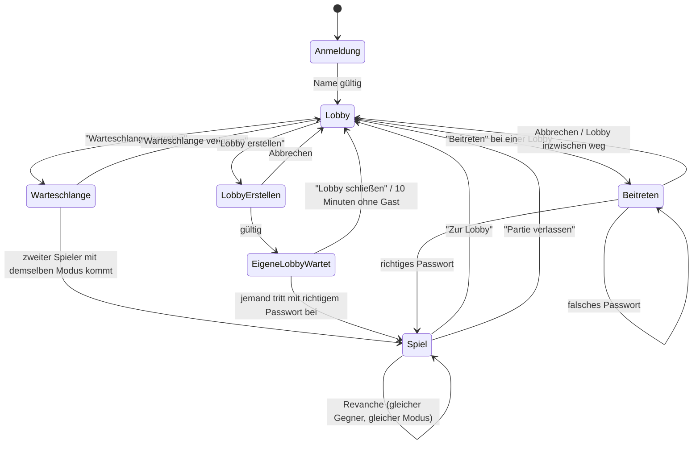

# Zoodle

Ein verteiltes Zwei-Personen-Spiel: Zwei Spieler raten abwechselnd dasselbe geheime
Tier. Jeder Tipp wird vom Server bewertet und **beiden** Spielern angezeigt. Wer das
Tier zuerst nennt, gewinnt.

Studienarbeit im Modul **W3WI_110.2 Web-Entwicklung**, DHBW Mannheim
Autor: Nico Breull

---

## Schnellstart

Ein Block, von oben nach unten kopierbar — es müssen keine Platzhalter ersetzt werden:

```bash
git clone https://github.com/Kina4You/zoodle-abgabe.git
cd zoodle-abgabe
npm install
npm run build
npm run 3000              # oder: npm start -- <beliebiger Port>
```

Das ist der Ablauf von Folie 6 (dort „`npm build`“ – siehe _Port festlegen_, warum es
`npm run build` heißt). Dann **http://localhost:3000** im Browser öffnen. Zum Spielen braucht es **zwei
Browser-Tabs oder -Fenster** – jeder Tab ist ein eigener Spieler, denn der Server
erkennt Spieler an ihrer Verbindung, nicht an Cookies. Nach der Anmeldung steht man in der Lobby: Klicken beide
auf **Warteschlange betreten**, startet die Partie. Alternativ eröffnet einer eine
private Lobby mit Passwort, und der andere tritt ihr bei.

Der Server gibt beim Start alle Adressen aus, unter denen er erreichbar ist,
inklusive IPv4 und IPv6:

```
  Zoodle laeuft (… Tiere geladen)

    http://localhost:3000
    http://192.168.0.10:3000
    http://[fe80::1234:5678:9abc:def0]:3000

  Beenden mit Strg+C
```

**Inhalt**

- [Zugang zum Code](#zugang-zum-code)
- [Betrieb](#betrieb)
- [Auf einem Server betreiben](#auf-einem-server-betreiben)
- [Voraussetzungen](#voraussetzungen)
- [Prüfwerkzeuge](#prüfwerkzeuge)
- [Projektstruktur](#projektstruktur)
- [Architektur](#architektur)
- [Ablauf der Kommunikation](#ablauf-der-kommunikation)
- [Zustände im Browser](#zustände-im-browser)
- [Lobby und Spielmodi](#lobby-und-spielmodi)
- [Zugzeit](#zugzeit)
- [Duell: zwei Bretter und Live-Druck](#duell-zwei-bretter-und-live-druck)
- [Spielregeln und Bewertung](#spielregeln-und-bewertung)
- [Entwurfsentscheidungen](#entwurfsentscheidungen)
- [Sicherheit](#sicherheit)
- [Tests](#tests)

---

## Zugang zum Code

Das Repository ist **öffentlich**: `github.com/Kina4You/zoodle-abgabe`. Eine
Anmeldung bei GitHub ist nicht nötig.

- **Als ZIP:** auf der Repo-Seite der grüne Knopf **„Code"** → **„Download ZIP"**,
  entpacken, in den Ordner wechseln und weiter ab `npm install`.
- **Mit HTTPS klonen:** `git clone https://github.com/Kina4You/zoodle-abgabe.git`
- **Mit SSH klonen:** `git clone git@github.com:Kina4You/zoodle-abgabe.git`

---

## Betrieb

### Port festlegen

Alle drei Varianten funktionieren:

```bash
npm start                 # Port 3000 (Standard)
npm start -- 8080         # Port als Argument – geht mit jedem Port
PORT=8080 npm start       # Port als Umgebungsvariable
npm run 3333              # wie auf Folie 6 – nur für 3000, 3333 und 8080
```

**Warum `npm run <port>` nur für drei Ports geht:** Folie 6 nennt `npm run <port>`.
`npm run` sucht in `package.json` ein Skript, das _genau so heißt_ wie das, was man
eintippt – Platzhalter wie „irgendeine Zahl“ kennt npm nicht. Deshalb stehen die
üblichen Ports als eigene Skripte drin (`"3333": "node server/server.js 3333"`), und
`tests/startbefehle.test.js` prüft, dass jedes auf seinem Port startet. Für jeden
anderen Port gilt `npm start -- <port>`. `npm build` aus der Folie gibt es in npm
nicht (`Unknown command`) – der Build heißt deshalb `npm run build`.

Ist der Port schon belegt, beendet sich der Server mit einer klaren Meldung und
schlägt den nächsten Port vor (`npm start -- 3001`) – statt mit einer Fehlermeldung
von Node abzubrechen.

### Im Hintergrund laufen lassen

`npm start` blockiert das Terminal. Für den Dauerbetrieb:

```bash
nohup npm start -- 3000 > zoodle.log 2>&1 &
```

`nohup` sorgt dafür, dass der Server weiterläuft, wenn man das Terminal schließt
oder die SSH-Verbindung trennt. Alle Ausgaben landen in `zoodle.log`.

Nachsehen, ob er läuft — und ihn wieder beenden:

```bash
ps aux | grep "[s]erver/server.js"    # zeigt den Prozess, falls er läuft
pkill -f "[s]erver/server.js"         # beendet ihn
tail -f zoodle.log                    # Log mitlesen, Abbruch mit Strg+C
```

Die eckigen Klammern um das erste Zeichen sind kein Tippfehler: Ohne sie steht das
Suchmuster selbst in der Kommandozeile und der Befehl findet sich selbst. Bei
`pkill` ist das gefährlich — es beendet dann die eigene Shell mit.

---

## Auf einem Server betreiben

Getestet auf Ubuntu 26.04 mit dem Hochschulserver der DHBW Mannheim. Node.js und das
Projekt liegen im Benutzerverzeichnis, die Schritte 1–3 brauchen **kein `sudo`**.
Nur der systemd-Dienst (4) und Caddy (5) werden einmalig mit `sudo` eingerichtet –
wer das nicht darf, nimmt stattdessen den Autostart über cron (weiter unten).

### 1. Verbinden

Der DHBW-Server ist von außen nur über VPN erreichbar (Cisco Secure Client,
`drogon.dhbw-mannheim.de`). Ohne aktives VPN läuft `ssh` in einen Timeout.

```bash
ssh ubuntu@2001:7c0:1b20:c913:1::2f4
```

### 2. Node.js über nvm installieren

Nur beim ersten Mal nötig. Der Node Version Manager installiert nach `~/.nvm` und
braucht keine Administratorrechte:

```bash
curl -o- https://raw.githubusercontent.com/nvm-sh/nvm/v0.40.1/install.sh | bash
source ~/.bashrc
nvm install --lts
nvm alias default lts/*
node --version        # zeigt die installierte Version, mindestens v20.11
```

`source ~/.bashrc` ist wichtig: Ohne diese Zeile kennt die laufende Sitzung den
Befehl `nvm` noch nicht.

### 3. Projekt holen und prüfen

```bash
git clone https://github.com/Kina4You/zoodle-abgabe.git ~/zoodle
cd ~/zoodle
npm install
npm run build
npm test
```

Alle Tests müssen grün sein, bevor es weitergeht. Die Anzahl steht am Ende der
Ausgabe von `npm test` – hier steht bewusst keine Zahl, sie würde nur veralten.

### 4. Als Dienst starten (systemd)

Zoodle läuft auf dem Server als **systemd-Dienst** `zoodle`. systemd startet es beim
Hochfahren und nach **jedem** Ende neu – Absturz, `kill`, Neustart des Rechners.
Die Dienstdatei `/etc/systemd/system/zoodle.service`:

```ini
[Unit]
Description=Zoodle - Rateduell fuer zwei Spieler (DHBW Web-Entwicklung)
After=network-online.target
Wants=network-online.target

[Service]
Type=simple
User=ubuntu
WorkingDirectory=/home/ubuntu/zoodle
# Voller Pfad: systemd kennt nvm nicht.
ExecStart=/home/ubuntu/.nvm/versions/node/v24.21.0/bin/node server/server.js 3333
Restart=always
RestartSec=2

[Install]
WantedBy=multi-user.target
```

Einrichten (einmalig, braucht `sudo`):

```bash
sudo nano /etc/systemd/system/zoodle.service     # Inhalt von oben
sudo systemctl daemon-reload
sudo systemctl enable --now zoodle               # jetzt starten + beim Hochfahren
```

Bedienen:

```bash
systemctl status zoodle              # läuft er? seit wann? letzte Logzeilen
sudo systemctl restart zoodle        # neu starten, z. B. nach einem Update
sudo systemctl stop zoodle           # anhalten (bleibt aus bis zum nächsten Start/Neustart)
journalctl -u zoodle -f              # Log live mitlesen, Ende mit Strg+C
journalctl -u zoodle --since today   # alles von heute
```

Getestet: Nach `kill -9` (wie ein echter Absturz) ist Zoodle nach 3 Sekunden wieder
da, nach `sudo reboot` von selbst ebenfalls.

### 5. HTTPS über Caddy

Auf dem DHBW-Server steht **Caddy** vor Zoodle: Caddy nimmt die HTTPS-Verbindungen an
(Zertifikat der DHBW) und reicht sie an `127.0.0.1:3333` weiter. `/etc/caddy/Caddyfile`:

```
zoodle.s252882-at-student-dhbw-mannheim-de.users.dhbw.site {
    tls /etc/caddy/certs/fullchain.pem /etc/caddy/certs/privkey.pem
    reverse_proxy 127.0.0.1:3333
}
```

Gespielt wird dann unter **https://zoodle.s252882-at-student-dhbw-mannheim-de.users.dhbw.site**
– `http://` leitet Caddy von selbst auf `https://` um. Direkt (ohne Verschlüsselung)
bleibt Zoodle unter `http://[2001:7c0:1b20:c913:1::2f4]:3333` erreichbar; die eckigen
Klammern gehören dort zur IPv6-Adresse.

**Die echte Adresse der Spieler.** Hinter Caddy kommen alle Verbindungen von
`127.0.0.1`. Damit die Grenzen je Adresse (3 offene Lobbys, Passwort-Sperre) nicht für
alle gemeinsam gelten, liest `server/adresse.js` die Kopfzeile `X-Forwarded-For`, die
Caddy mitschickt – aber **nur** für Verbindungen vom eigenen Rechner. Wer direkt auf
Port 3333 kommt, kann sich mit einer gefälschten Kopfzeile keine neue Adresse ausdenken.

### 6. Auf einen neueren Stand bringen

```bash
cd ~/zoodle
git pull
npm install
npm test
sudo systemctl restart zoodle
```

Bricht `git pull` mit _"Your local changes to the following files would be
overwritten"_ für `package-lock.json` ab, hat `npm install` die Datei verändert.
Sie wird ohnehin erzeugt und kann verworfen werden:

```bash
git checkout -- package-lock.json
git pull
```

### Ohne `sudo`: Autostart über cron

Wer kein `sudo` hat, kann statt systemd `scripts/zoodle-start.sh` nehmen: `cron` ruft
es beim Hochfahren und alle 5 Minuten auf, und es startet Zoodle nur, wenn es nicht
schon läuft. **Nicht beides zugleich** einrichten – sonst streiten sich systemd und
cron um den Port.

```bash
( crontab -l 2>/dev/null; \
  echo "@reboot $HOME/zoodle/scripts/zoodle-start.sh 3333"; \
  echo "*/5 * * * * $HOME/zoodle/scripts/zoodle-start.sh 3333" ) | crontab -
```

Dienst und Skript sind nur Betrieb, kein Teil des Spiels: Dass der Server bei Fehlern
nicht abstürzt, steckt im Code selbst (siehe _Der Server stürzt nicht ab_). Sie helfen
in den Fällen, gegen die kein Code im Spiel etwas tun kann – ein Neustart des Rechners
oder ein von außen beendeter Prozess.

### Was dabei zu beachten ist

- **Von außen sind auf dem DHBW-Server nur 80 und 443 (Caddy) sowie 3333 offen.**
  Andere Ports blockt die Firewall.
- **Die Spieladresse hat nur einen IPv6-Eintrag (AAAA), keinen für IPv4.** Über IPv6
  ist sie von überall erreichbar, auch ohne VPN (geprüft am 26.10. aus einem Heimnetz).
  Ein Gerät ohne IPv6 kommt nicht hin – dann hilft das DHBW-Netz bzw. das VPN.

---

## Voraussetzungen

|                |                                                                                                                                                                                     |
| -------------- | ----------------------------------------------------------------------------------------------------------------------------------------------------------------------------------- |
| Node.js        | zum Spielen ab Version 18, für `npm test` ab 20.11 (die Tests simulieren die Uhr mit `mock.timers`), für `npm run lint` ab 18.18 (Vorgabe von ESLint 9); getestet mit 18, 22 und 24 |
| Abhängigkeiten | zum Spielen nur `express` und `socket.io`; zum Testen und Prüfen zusätzlich `socket.io-client`, `eslint`, `@eslint/js`, `globals` und `prettier` (alle als devDependency)           |
| Browser        | Firefox, Safari, Chrome — jeweils aktuelle Version                                                                                                                                  |
| Auflösung      | ab 1024 × 768 Pixel                                                                                                                                                                 |

Es gibt **keinen Übersetzungsschritt**: HTML, CSS und JavaScript laufen genau so, wie
sie im Repository liegen. `npm run build` prüft stattdessen die Syntax **aller**
JavaScript-Dateien (`server/`, `public/js/`, `scripts/`, `tests/` – das Skript sammelt
sie selbst ein, eine neue Datei ist automatisch dabei) und die Vollständigkeit der Tierdaten — der Build schlägt also fehl,
bevor der Server mit kaputten Daten startet. Außerdem bricht er ab, sobald unter
`public/` irgendwo `!important` steht (Vorgabe des Dozenten).

Die Schriften liegen im Projekt (`public/fonts/`). Das Spiel lädt **nichts** von
fremden Servern nach und funktioniert ohne Internetverbindung.

---

## Prüfwerkzeuge

| Befehl                 | Was es prüft                                                                                                                                         |
| ---------------------- | ---------------------------------------------------------------------------------------------------------------------------------------------------- |
| `npm test`             | Spielregeln, Partien, Lobbys, Zugzeit und den echten Server über Socket.io – siehe [Tests](#tests).                                                  |
| `npm run build`        | Syntax aller JavaScript-Dateien, Vollständigkeit der Tierdaten und dass unter `public/` kein `!important` steht.                                     |
| `npm run lint`         | ESLint mit den empfohlenen Regeln: ungenutzte Variablen, Namen, die es nicht gibt, Code, der nie erreicht wird. Einstellungen in `eslint.config.js`. |
| `npm run format:check` | Ob alle Dateien so formatiert sind, wie Prettier es nach `.prettierrc.json` vorgibt – ändert nichts.                                                 |
| `npm run format`       | Formatiert alle Dateien mit Prettier (einfache Anführungszeichen, Einrückung 2, Zeilenbreite 100).                                                   |

`npm run lint` und `npm run format:check` sind bewusst **nicht** Teil von
`npm run build`: Der Build soll nach dem Auschecken nur an echten Fehlern scheitern,
nie an einer Stilfrage.

Die einmalige Umformatierung mit Prettier steht in `.git-blame-ignore-revs`. GitHub
überspringt sie deshalb in der Blame-Ansicht und zeigt dort weiter, wann eine Zeile
inhaltlich entstanden ist (lokal: `git config blame.ignoreRevsFile .git-blame-ignore-revs`).

---

## Projektstruktur

```
zoodle-abgabe/
├── eslint.config.js          Regeln für "npm run lint" (nicht Teil des Builds)
├── .prettierrc.json          Stil für "npm run format" (plus .prettierignore)
├── .git-blame-ignore-revs    Reine Formatierungs-Commits, die blame überspringt
├── data/
│   └── tiere.json            über hundert Lebewesen mit je 7 Eigenschaften
├── server/
│   ├── server.js             HTTP + Socket.io, verdrahtet die Module
│   ├── partien.js            Warteschlange und Partieverwaltung
│   ├── lobbys.js             Private Lobbys mit Passwort, Spielmodus und Zugzeit
│   ├── zugzeit.js            Die Uhr pro Zug - läuft nur hier auf dem Server
│   ├── adresse.js            Echte Spieleradresse hinter dem HTTPS-Proxy (Caddy)
│   ├── namen.js              Spielernamen bereinigen (unsichtbare Zeichen, Länge)
│   ├── spiel.js              Spielregeln und Bewertungslogik
│   └── tierdaten.js          Laden und Prüfen der Tierliste
├── public/
│   ├── index.html            Semantisches HTML: Lobby, Spielfeld, Dialoge
│   ├── favicon.svg
│   ├── fonts/                Caprasimo und Figtree
│   ├── css/
│   │   ├── schriften.css     @font-face
│   │   ├── tokens.css        Farben, Schriften, Abstände
│   │   ├── basis.css         Reset, Seitenaufbau, Typografie
│   │   ├── komponenten.css   Knöpfe, Felder, Karten, Spielermarken, Dialog
│   │   ├── spielfeld.css     Tabelle, Kacheln, Vorschlagsliste
│   │   ├── lobby.css         Lobby, Lobbyliste, Lobby-Dialoge
│   │   ├── duell.css         Duell: zwei Bretter, Gefahrenstufe, Finale
│   │   └── szene.css         Lebensraum-Szene als Seitenhintergrund
│   └── js/
│       ├── client.js         Ansichtssteuerung und Socket-Kommunikation
│       ├── lobby.js          Lobbyliste, Dialoge, Passwortfelder
│       ├── spielfeld.js      Rendert die Tipp-Tabelle und die Duell-Bretter
│       ├── fortschritt.js    Duell: geknackt, Gefahrenstufe, Meilensteine (ohne DOM)
│       ├── zuguhr.js         Zeigt die Restzeit an (misst nichts)
│       └── vorschlaege.js    Eigene Autocomplete-Komponente
├── scripts/
│   ├── pruefe-syntax.js      "node --check" für alle JavaScript-Dateien
│   ├── pruefe-daten.js       Wird von "npm run build" aufgerufen
│   ├── pruefe-important.js   Build bricht ab, sobald unter public/ "!important" steht
│   └── zoodle-start.sh       Autostart über cron (ohne sudo), kein Teil des Builds
└── tests/
    ├── server.test.js        Integrationstests gegen den echten Server
    ├── spiel.test.js         Bewertungslogik und Spielablauf
    ├── partien.test.js       Warteschlange, Partien, Revanche
    ├── lobbys.test.js        Lobbys, Passwort-Hash, Sperre, Grenzen
    ├── zugzeit.test.js       Zugzeit mit simulierter Uhr (mock.timers)
    ├── fortschritt.test.js   Fortschritt, Stufengrenzen, Meilenstein-Sätze
    ├── tierdaten.test.js     Tierdaten und Suche
    ├── vorschlaege.test.js   Reihenfolge der Vorschlagsliste
    ├── important.test.js     Build-Prüfung gegen "!important"
    ├── syntax.test.js        Build-Prüfung auf Syntaxfehler
    ├── adresse.test.js       Echte Adresse hinter dem Proxy, Fälschung von außen
    ├── namen.test.js         Unsichtbare Zeichen, Akzente, Kürzen nach ganzen Zeichen
    ├── startbefehle.test.js  "npm run 3000/3333/8080" starten auf ihrem Port
    └── kontrast.test.js      Farbkontraste nach WCAG, gerechnet aus tokens.css
```

---

## Architektur



Die dick gezeichnete Linie ist der Spielbetrieb, die gestrichelte der einmalige
Download der Tierliste. Caddy steht nur auf dem DHBW-Server davor und sorgt für HTTPS;
lokal spricht der Browser Zoodle direkt an.

**Der wichtigste Punkt:** `spiel.js` und das gesuchte Tier liegen ausschließlich auf
dem Server. Der Browser erfährt nie, welches Tier gesucht ist — er bekommt nur die
_Bewertung_ seiner Tipps. Erst beim Spielende wird die Lösung mitgeschickt.

---

## Ablauf der Kommunikation



Klickt einer der beiden stattdessen **Zur Lobby**, verfällt sein Angebot und
der andere bekommt `revancheGeplatzt` – auch wenn er selbst noch gar nicht geklickt
hat. Sein Knopf zeigt dann den Grund, statt ins Leere zu führen. Dasselbe
passiert, wenn er die Verbindung verliert oder direkt in Warteschlange oder Lobby
weiterzieht. Beide Wege behalten den Spielernamen
und die bestehende Verbindung: Die Seite wird nicht neu geladen.

**Duell mit Zugzeit.** Im Duell wählt zuerst jeder ein Tier für den anderen, danach
wird abwechselnd geraten – mit der Uhr, die nur auf dem Server läuft:



Wählt einer der beiden innerhalb der 60 Sekunden kein Tier, beendet der Server die
Partie mit `wahlAbgelaufen`: Wer gewählt hat, gewinnt. Haben beide nicht gewählt,
endet sie ohne Sieger. In einer Lobby **ohne Zeitlimit** gibt es weder Zugzeit noch
Wahlfrist – dann entfallen `zeitAbgelaufen` und `wahlAbgelaufen`.

Wie eine **private Lobby** abläuft, steht im Abschnitt
[Lobby und Spielmodi](#lobby-und-spielmodi).

### Nachrichtenübersicht

**Client → Server**

| Ereignis                 | Nutzdaten                                                                                          |
| ------------------------ | -------------------------------------------------------------------------------------------------- |
| `anmelden`               | Spielername – führt in die Lobby; der Server entfernt unsichtbare Zeichen und kürzt auf 20 Zeichen |
| `warteschlangeBetreten`  | `{ modus }` – ohne Angabe Zufallstier                                                              |
| `warteschlangeVerlassen` | –                                                                                                  |
| `lobbyErstellen`         | `{ modus, passwort, zugzeit }` – Zugzeit 10, 20, 30, 60 oder 0 (ohne Limit)                        |
| `lobbySchliessen`        | –                                                                                                  |
| `lobbyBeitreten`         | `{ lobbyId, passwort }`                                                                            |
| `tierWaehlen`            | Tiername – nur im Duell: das Tier, das der **Gegner** erraten muss                                 |
| `raten`                  | Tiername                                                                                           |
| `aufgeben`               | – „Partie verlassen“: beendet die eigene Partie, der Gegner bekommt `gegnerWeg`                    |
| `tippt`                  | **keine Daten** – Duell: „ich tippe gerade“, nie Buchstaben                                        |
| `revanche`               | –                                                                                                  |
| `zurLobby`               | – von der Endkarte zurück in die Lobby                                                             |

**Server → Client**

| Ereignis             | Nutzdaten                                                                                                                                                                                                                              |
| -------------------- | -------------------------------------------------------------------------------------------------------------------------------------------------------------------------------------------------------------------------------------- |
| `lobbyBetreten`      | `{ name }` – der Name, wie der Server ihn gespeichert hat                                                                                                                                                                              |
| `lobbyListe`         | `[{ id, erstellerName, modus, zugzeit }]` – neueste zuerst, nie mit Passwort                                                                                                                                                           |
| `warten`             | `{ modus, zugzeit }` – man steht in der Warteschlange dieses Modus (immer 10 s)                                                                                                                                                        |
| `lobbyErstellt`      | `{ modus, zugzeit }`                                                                                                                                                                                                                   |
| `erstellenAbgelehnt` | `{ grund }`: `passwort`, `modus`, `zugzeit`, `voll`, `zuVieleVonDir`, `beschaeftigt` oder `schonOffen` – Letzteres nur, wenn zwei Anfragen gleichzeitig ankommen und schon eine Lobby offen ist (nur mit manipuliertem Client möglich) |
| `lobbyAbgelaufen`    | – die eigene Lobby wurde nach 10 Minuten ohne Gast geschlossen                                                                                                                                                                         |
| `beitrittAbgelehnt`  | `{ grund }`: `passwort`, `voll`, `weg`, `gesperrt` oder `beschaeftigt`                                                                                                                                                                 |
| `spielStart`         | `gegnerName`, `duBistDran`, `kategorien`, `modus`, `zugzeit`, `wahlzeit`, `restzeitMs`                                                                                                                                                 |
| `tierGewaehlt`       | `{ tierName, restzeitMs }` – Duell: Bestätigung der eigenen Wahl, dazu die restliche Wahlfrist                                                                                                                                         |
| `gegnerHatGewaehlt`  | – Duell: der Gegner hat gewählt (aber nicht, **was**)                                                                                                                                                                                  |
| `duellStart`         | `{ duBistDran, restzeitMs }` – Duell: beide haben gewählt, das Raten beginnt                                                                                                                                                           |
| `zug`                | `raterName`, `vonMir`, `tierName`, `hinweise`, `richtig`, `duBistDran`, `restzeitMs`                                                                                                                                                   |
| `zeitAbgelaufen`     | `{ duBistDran, restzeitMs }` – die Zeit ist um, der Zug geht ohne Tipp an den anderen                                                                                                                                                  |
| `wahlAbgelaufen`     | `{ duHastGewonnen }` – Duell: die Wahlfrist ist um; `null`, wenn keiner gewählt hat                                                                                                                                                    |
| `gegnerTippt`        | **keine Daten** – Duell: der Gegner tippt gerade                                                                                                                                                                                       |
| `spielEnde`          | `gewinnerName`, `duHastGewonnen`, `geheimnis`, `anzahlTipps` (im Duell: Tipps des Gewinners)                                                                                                                                           |
| `gegnerWeg`          | `{ geheimnis, aufgegeben }` – `aufgegeben`, wenn der Gegner „Partie verlassen“ geklickt hat                                                                                                                                            |
| `revancheWartet`     | –                                                                                                                                                                                                                                      |
| `revancheAngeboten`  | –                                                                                                                                                                                                                                      |
| `revancheGeplatzt`   | kurzer Grund (steht direkt auf dem Knopf)                                                                                                                                                                                              |
| `fehler`             | Meldungstext                                                                                                                                                                                                                           |

`restzeitMs` ist die Restzeit des Spielers, der **jetzt** dran ist, in Millisekunden –
In der Duell-Wahl ist es die restliche Wahlfrist.
`null` heißt: keine Frist (ohne Zeitlimit oder Partie vorbei).
Verschickt wird bewusst nie eine Uhrzeit (siehe [Zugzeit](#zugzeit)).

---

## Zustände im Browser



Die Endkarte ist keine Sackgasse: Wer dort auf **Revanche** klickt, bleibt auf ihr
stehen, bis der Server mit `spielStart` antwortet; **Zur Lobby** führt zurück in die
Lobby. Nur bei verlorener Verbindung laden die beiden Knöpfe die Seite neu – ein
`emit` über einen toten Socket käme nirgends an.

Während einer laufenden Partie fragt der Browser nach, bevor man den Tab schließt oder
zurückgeht (`beforeunload`) – sonst wäre die Partie für beide sofort vorbei. In der
Lobby und auf der Endkarte kommt keine Rückfrage.

Lobby, Spielfeld und Endkarte liegen gleichzeitig im HTML und werden über das
`hidden`-Attribut ein- und ausgeblendet (`client.js`, z. B. `spielbereich.hidden
= false`). Dadurch gibt es beim Umschalten kein Nachladen und keine Wartezeit.
Lobby und Spielfeld sind zwei `<section>` in **einem** gemeinsamen `<main>`.

Die Ausnahme sind die Dialoge (Anmeldung, Lobby erstellen, Beitreten, eigene Lobby,
Warteschlange): Sie sind echte `<dialog>`-Elemente und werden mit `showModal()`
geöffnet und mit `close()` geschlossen. Abdunkeln (`::backdrop`), Zentrieren und das
Sperren der Seite dahinter übernimmt der Browser. Bei der Anmeldung und in den beiden
Wartedialogen darf Esc nicht schließen. Das `cancel`-Ereignis wird abgefangen, und
weil Chrome sich das ohne vorherigen Klick nicht verbieten lässt, öffnet sich der
Dialog sofort wieder, falls er sich trotzdem schließt (`haltOffen` in `lobby.js`).

Bewusst das Attribut und keine eigene CSS-Klasse: `hidden` ist Teil von HTML,
Screenreader respektieren es von sich aus. Damit eine Klasse wie `.karte` mit
`display: flex` es nicht versehentlich übersteuert, liegt die Regel
`[hidden] { display: none; }` in der Kaskadenebene `zustand`. Jede CSS-Datei steckt
in ihrer eigenen Ebene (`@layer`), die Reihenfolge steht am Anfang von
`schriften.css`: `schriften, tokens, basis, komponenten, spielfeld, lobby, duell, szene, zustand`.
Eine spätere Ebene gewinnt immer, egal wie spezifisch der Selektor der früheren
ist. `zustand` steht ganz hinten, deshalb setzt sich `[hidden]` durch.

Animationen und Übergänge stehen ausschließlich in
`@media (prefers-reduced-motion: no-preference) { … }`. Wer im Betriebssystem
„Bewegung reduzieren“ eingestellt hat, bekommt sie also gar nicht erst, und es muss
nichts überschrieben werden.

Keine Animation läuft endlos: Bewegung, die von selbst startet, darf höchstens
5 Sekunden dauern (WCAG 2.2.2). Statt `infinite` steht überall eine feste Anzahl, die
Rechnung steht jeweils im Kommentar daneben – der Revanche-Knopf pulsiert dreimal
(4,2 s), die Wartepunkte dreimal (4,0 s), „tippt …“ viermal (4,3 s, startet bei jedem
neuen Signal neu), die knappe Zuguhr wackelt sechsmal (3 s).

**Spielmomente.** Ein paar kurze Bewegungen machen gute Nachrichten spürbar – alle
einmalig, alle unter „Bewegung reduzieren“ abgeschaltet:

| Moment       | Was passiert                                                                    | Dauer     |
| ------------ | ------------------------------------------------------------------------------- | --------- |
| Treffer      | Die grüne Kachel federt beim Aufdecken kurz nach                                | 0,7 s     |
| Du bist dran | Die eigene Spielermarke hüpft zweimal – nur beim Wechsel zu einem selbst        | 0,8 s     |
| Siegtipp     | Die Treffer der Gewinnzeile leuchten nach dem Aufdecken zweimal honigfarben auf | bis 2,6 s |
| Sieg         | Die Endkarte springt auf, 14 Konfetti-Schnipsel fallen einmal herab             | bis 2,8 s |

Das Konfetti baut `feiereSieg()` in `client.js` mit `createElement` in einem Behälter
mit `aria-hidden` (der Sieg steht ohnehin im Text). Zufällig sind nur Ort, Start und
Drehung; sie gehen als CSS-Variablen über `style.setProperty` an die Schnipsel – das
erlaubt die Content-Security-Policy, ein `style`-Attribut nicht. Klicks gehen durch
das Konfetti hindurch (`pointer-events: none`), nach 3 Sekunden ist es wieder weg.

---

## Lobby und Spielmodi

Nach der Anmeldung steht man in der **Lobby** und wählt einen von drei Wegen ins Spiel:

- **Schnell spielen** – öffentliche Warteschlange mit Moduswahl. Jeder Modus hat
  seine **eigene** Warteschlange: Der Server paart die ersten beiden Wartenden, die
  denselben Modus gewählt haben.
- **Eigene Lobby** – privat, mit Passwort und frei wählbarem Modus. Die Lobby erscheint
  sofort in der Liste aller, die gerade in der Lobby stehen.
- **Beitreten** – einer privaten Lobby aus der Liste, mit dem Passwort vom Ersteller.

**Abweichung von der Vorgabe.** Laut Aufgabenstellung werden Spieler nach der
Anmeldung automatisch miteinander verbunden. Zoodle schiebt dazwischen die Lobby. Der
Pflichtablauf bleibt trotzdem vollständig erhalten: **„Schnell spielen“** verbindet
automatisch mit dem nächsten Wartenden desselben Modus – Login, Wartebildschirm,
Partie. Die privaten Lobbys sind ein **Zusatz** für alle, die gezielt gegeneinander
spielen wollen, und ersetzen den Pflichtablauf nicht.



**Die Lobbyliste ist live.** Wer frei in der Lobby steht, ist auf dem Server im
Socket.io-**Raum** `lobby`. Ändert sich die Liste – neue Lobby, besetzt, geschlossen,
Ersteller weg –, schickt der Server `lobbyListe` per `io.to('lobby').emit(...)` an
genau diese Spieler. Wer wartet oder spielt, ist nicht im Raum; deshalb steht die
eigene Lobby nie in der eigenen Liste.

**Viele Lobbys, kleine Bildschirme.** Geprüft mit 50 offenen Lobbys (der Obergrenze)
bei 1280, 1024, 768 und 390 Pixel Breite:

- Die Liste scrollt in sich – höchstens `min(60vh, 32rem)` hoch. Überschrift, Anzahl
  und Fußzeile bleiben sichtbar; die Seite ist auf dem Desktop gut eine Bildschirmhöhe
  hoch.
- **Suche** nach dem Namen des Erstellers und **Filter** nach Modus (Alle /
  Zufallstier / Duell), beides im Browser. Die Anzahl zeigt dann „2 von 50 offen“,
  Screenreader hören nach einer kurzen Tipp-Pause, wie viele Lobbys passen.
- Unter 900 px stehen die Wege über der Liste, unter 560 px bricht ein Eintrag in zwei
  Zeilen um. Lange Namen brechen um, statt abgeschnitten zu werden. Bei keiner der vier
  Breiten scrollt die Seite waagerecht.
- Stolperstein: Die unsichtbaren `.nur-sr`-Texte sind `position: absolute`. Jeder
  Scrollbereich, der sie enthält (Lobbyliste, Tabelle), braucht `position: relative`
  – sonst beziehen sie sich auf die ganze Seite, werden nicht abgeschnitten und machen
  sie unsichtbar länger oder breiter.

**Regeln, die der Server durchsetzt** (`server/lobbys.js`, ohne Socket.io testbar):

| Regel                                                               | Umsetzung                                                                                                                                                                                                                                                                                                           |
| ------------------------------------------------------------------- | ------------------------------------------------------------------------------------------------------------------------------------------------------------------------------------------------------------------------------------------------------------------------------------------------------------------- |
| Passwort 4 bis 32 Zeichen                                           | geprüft beim Erstellen; der Browser prüft vorher nur aus Komfort                                                                                                                                                                                                                                                    |
| Passwort nie im Klartext                                            | `scrypt` mit 16 Byte Salz aus `node:crypto`, Vergleich mit `timingSafeEqual`                                                                                                                                                                                                                                        |
| Passwortprüfung hält den Server nicht an                            | `scrypt` läuft **asynchron** in einem Hilfsthread, höchstens 4 gleichzeitig (`MAX_GLEICHZEITIGE_PRUEFUNGEN`), sonst `beschaeftigt`. Vorher (`scryptSync`) stand der ganze Server je Prüfung rund 35 ms still: Unter 200 falschen Passwörtern wartete ein unbeteiligter Spieler bis zu 1,9 s, jetzt höchstens 10 ms. |
| Liste ohne Geheimnisse                                              | an Clients gehen nur `id`, `erstellerName`, `modus`, `zugzeit` – nie Passwort, Hash, Socket-Kennung oder IP-Adresse                                                                                                                                                                                                 |
| 5 falsche Passwörter                                                | 30 Sekunden Sperre – je **IP-Adresse** und je Lobby, auch für das richtige Passwort. Trennen und neu verbinden hebt sie nicht auf.                                                                                                                                                                                  |
| Zwei treten gleichzeitig bei                                        | Nach dem `await` (Hashen) prüft `lobbys.js` alles neu – Lobby noch da, noch frei, Spieler noch verbunden und frei – und besetzt erst dann, in einem Stück ohne weiteres `await`. Wer zuerst ankommt, ist drin; der Zweite bekommt `voll`.                                                                           |
| Höchstens eine Lobby pro Spieler, 50 insgesamt                      | sonst `erstellenAbgelehnt`                                                                                                                                                                                                                                                                                          |
| Höchstens 3 offene Lobbys je IP-Adresse (`MAX_LOBBYS_PRO_ADRESSE`)  | Sonst könnte einer mit 50 Tabs alle Plätze belegen. Nicht 1, weil am Spieltag viele über dasselbe Hochschulnetz kommen. Sonst `zuVieleVonDir`.                                                                                                                                                                      |
| Eine Lobby ohne Gast schließt nach 10 Minuten (`LOBBY_LEBENSDAUER`) | Der Server sieht alle 30 Sekunden nach. Der Ersteller landet in der Lobby und bekommt `lobbyAbgelaufen`, die Liste aktualisiert sich bei allen.                                                                                                                                                                     |
| Niemand wartet an zwei Orten                                        | `pruefeFrei()` in `server.js`: nicht in Partie, Warteschlange oder eigener Lobby                                                                                                                                                                                                                                    |
| Ende einer Lobby                                                    | mit dem Spielende, mit „Lobby schließen“, wenn der Ersteller die Verbindung verliert oder nach 10 Minuten ohne Gast                                                                                                                                                                                                 |

**Spielmodi.** Jede Partie (`Spiel` in `spiel.js`) hat ein Feld `modus`, und
`spielStart` schickt es mit. Eine Revanche behält den Modus.

- **Zufallstier** – Der Server lost ein Tier aus, beide raten darauf.
- **Duell** – beim schnellen Spiel und in privaten Lobbys. Die Partie beginnt mit der **Wahl**: Jeder
  sucht über das gewohnte Eingabefeld ein Tier für den anderen aus (`tierWaehlen`).
  Haben beide gewählt (`duellStart`), wird abwechselnd geraten – jeder auf das Tier,
  das der andere für ihn gewählt hat. Wer zuerst richtig liegt, gewinnt.

Was im Duell anders ist und warum:

| Regel                                                           | Grund                                                                                                                                                                                                                                                                                                   |
| --------------------------------------------------------------- | ------------------------------------------------------------------------------------------------------------------------------------------------------------------------------------------------------------------------------------------------------------------------------------------------------- |
| Vor der Wahl darf niemand raten                                 | Es gibt noch kein Tier, gegen das bewertet werden könnte.                                                                                                                                                                                                                                               |
| Die Wahl bleibt bis zum Spielende geheim                        | Der Gegner bekommt nur `gegnerHatGewaehlt`, nie den Tiernamen – wie beim Zufallstier verlässt das gesuchte Tier den Server erst am Ende.                                                                                                                                                                |
| „Schon geraten“ zählt nur die eigenen Tipps                     | Was der Gegner geraten hat, kann genau das Tier sein, das ich suche.                                                                                                                                                                                                                                    |
| Beide sehen alle Tipps                                          | Jede Zeile ist mit „Du“ oder dem Gegnernamen beschriftet; ihre Hinweise beziehen sich auf das Tier, das **dieser** Spieler sucht.                                                                                                                                                                       |
| `spielEnde` und `gegnerWeg` verraten jedem sein eigenes Tier    | Der Verlierer erfährt, was er gesucht hat.                                                                                                                                                                                                                                                              |
| Für die Wahl gibt es **60 Sekunden** (`WAHLZEIT_SEKUNDEN`)      | Sonst könnte einer nie wählen und den anderen ewig warten lassen. Läuft die Frist ab, gewinnt, wer gewählt hat; hat keiner gewählt, endet die Partie ohne Sieger. In einer Lobby **ohne Zeitlimit** gibt es auch keine Wahlfrist.                                                                       |
| Knopf „Partie verlassen“ in jeder laufenden Partie (`aufgeben`) | Der Ausweg, ohne auf die Wahlfrist zu warten – und in einer Lobby ohne Zeitlimit die einzige Möglichkeit, wenn der Gegner nie rät. Für den Gegner ist es wie eine Trennung, er erfährt das gesuchte Tier. Der Server nimmt die Partie aus der Socket-Kennung – eine fremde lässt sich so nicht beenden. |

Im Code: `Spiel` (`spiel.js`) hat dafür `phase` (`'wahl'` / `'raten'`), `ziele`
(Spieler → zu erratendes Tier), `waehleTier()` und `geheimnisVon()`. Die Prüfung in
`behandleTierwahl()` (`server.js`) läuft wie das Raten ohne `await`.

**Barrierefreiheit.**

- Die Lobbyliste ist eine `<ul>`. Jeder „Beitreten“-Knopf trägt einen vollen Namen
  für Screenreader („Beitreten – Lobby von Lena, Modus Zufallstier“); der sichtbare
  Text steht vorne, damit Sprachsteuerung ihn findet.
- Der Modus ist ein `<fieldset>` mit echten Radio-Knöpfen.
- Passwortfelder und das Namensfeld haben ein sichtbares Label. Hinweis und Fehler
  hängen über `aria-describedby` am Feld, der Fehler zusätzlich mit
  `aria-invalid="true"` – beides setzt eine gemeinsame Funktion, `setzeFeldfehler()`.
- Der Knopf **„Passwort anzeigen“** behält seine Beschriftung; ob er gedrückt ist, sagt
  allein `aria-pressed`. Ein wechselnder Text („Verbergen“) hätte zusammen mit
  „gedrückt“ das Gegenteil vorgelesen.
- Die Zeit-Knöpfe heißen sichtbar und vorgelesen gleich („10 Sek.“), damit
  Sprachsteuerung sie unter dem sichtbaren Namen findet.
- **Farbkontraste** sind im Browser nachgemessen (zuletzt 26.10., mit der Palette
  Smaragd, Honig, Koralle): jeder Text mindestens 4,5 : 1, Fokusrahmen mindestens
  4,4 : 1, Rahmen von Eingabefeldern und gewählten Optionen mindestens 3,5 : 1. Bei Rot-, Grün- und Blauschwäche bleiben die drei
  Kachelarten an der Helligkeit unterscheidbar (dunkel, mittel, hell) und tragen
  zusätzlich ✓ ~ ✕. `tests/kontrast.test.js` rechnet die wichtigsten Paare nach.
- Im **Kontrastmodus** (`forced-colors`) bekommen Kacheln und Legende Rahmen in
  unterschiedlicher Linienart (durchgezogen, gestrichelt, gepunktet), weil die
  Hintergrundfarben dort wegfallen.
- **Ansagen in Dialogen:** Solange ein modaler Dialog offen ist, sperrt der Browser
  alles außerhalb für Screenreader – auch die Region `#ansage`. Jeder Dialog hat
  deshalb eine eigene, leere Ansage-Region, und `sage()` schreibt automatisch in die
  des offenen Dialogs.
- **Fokus:** Nach dem Schließen eines Dialogs kehrt er zum Knopf zurück, der ihn
  geöffnet hat. Verschwindet die Lobby, deren Knopf gerade fokussiert ist, springt er
  auf die Überschrift „Private Lobbys“. Ist sie weg, während ihr Dialog offen ist,
  bleibt nur „Abbrechen“ aktiv.

---

## Zugzeit

Jeder Zug hat eine Frist: **öffentlich immer 10 Sekunden**, in einer privaten Lobby
wählbar (10, 20, 30, 60 Sekunden oder **ohne Zeitlimit**). Läuft sie ab, geht der Zug
**ohne Tipp** an den anderen. Im Duell läuft während der Wahl stattdessen die
**Wahlfrist von 60 Sekunden** (ohne Zeitlimit: keine) – dieselbe Uhr, nur mit anderer Dauer.

**Barrierefreiheit: Warum öffentlich trotzdem 10 Sekunden gelten (WCAG 2.2.1).**
Eine Zeitgrenze muss sich normalerweise abschalten, verlängern oder anpassen lassen.
Ausgenommen sind Grenzen, die **wesentlich** für das Spiel sind – und das schnelle,
öffentliche Spiel lebt vom Zeitdruck. Vertretbar ist die Ausnahme, weil es eine
gleichwertige Alternative gibt: Eine private Lobby lässt sich **ohne Zeitlimit**
eröffnen (dann auch ohne Wahlfrist im Duell). Das steht auch in den Spielregeln auf der
Startseite, damit es jeder findet.

**Warum die Uhr nur auf dem Server läuft.** Würde der Browser die Zeit messen, könnte
ein Spieler sie einfach anhalten – mit den Entwicklerwerkzeugen oder einer verstellten
Rechneruhr – und beliebig lange nachdenken. Deshalb gilt wie bei allen Spielregeln:
**Der Server entscheidet, der Browser zeigt nur an.**

- `server/zugzeit.js` (ohne Socket.io) startet bei jedem Zugwechsel eine Frist pro
  Partie. Läuft sie ab, gibt `server.js` den Zug weiter und schickt `zeitAbgelaufen`.
- Ein Tipp, der nach dem Fristende eintrifft, aber bevor Node den Ablauf bearbeitet
  hat, wird abgelehnt („Deine Zeit ist abgelaufen.“).
- Aufgeräumt wird bei Spielende und Trennung; eine Revanche übernimmt die Zugzeit.
- Der Server verschickt nur die **Restzeit** (`restzeitMs`), nie eine Uhrzeit. Die Uhren
  von Server und Browser gehen nie genau gleich – eine Restzeit bleibt auch dann
  richtig, wenn der Rechner des Spielers falsch eingestellt ist.

**Im Browser** zählt `public/js/zuguhr.js` die Restzeit nur für die Anzeige herunter:
Zahl (immer sichtbar), Balken und Farbe – grün, ab 5 Sekunden orange, ab 3 Sekunden
dunkles Rotbraun mit kurzem Wackeln (nur bei `no-preference`, höchstens 3 Sekunden).
Beide sehen die Uhr („Deine Zeit“ bzw. „Zeit von Lena“), im Duell steht sie zusätzlich
im Brett des Gegners, wenn er dran ist. Die Uhr hat `role="timer"`: Der Screenreader
liest den Sekundentakt nicht vor. Angesagt werden nur „Noch 5 Sekunden.“ (für den,
der dran ist) und der Zugwechsel beim Ablauf.

**Tests ohne Warten:** `tests/zugzeit.test.js` simuliert Zeitgeber und Uhr mit
`mock.timers` aus `node:test`. Für die Integrationstests startet ein zweiter Server mit
`ZUGZEIT_MS_PRO_SEKUNDE=50` – dort dauern 10 Sekunden nur eine halbe. Ohne diese
Umgebungsvariable hat sie keine Wirkung.

---

## Duell: zwei Bretter und Live-Druck

In der Ratephase eines Duells sieht jeder **zwei Bretter** untereinander:

- **Oben „Lenas Brett“** (Gegner), kompakt: Fortschritt („5 von 7 geknackt“),
  **Gefahrenstufe**, „Lena tippt …“, **Meilenstein** und eine Spurkarte pro Tipp
  (Tiername + sieben Bewertungen ✓ ~ ✕, ohne Werte).
- **Darunter „Dein Brett“**: die gewohnte große Tabelle, aber nur mit den eigenen
  Tipps („Tipp 4“ statt Spielername). `client.js` hängt dafür dasselbe `<table>`-Element
  um – es gibt nur eine Tabelle und nur einen Code, der sie füllt.
- **Untereinander, nicht nebeneinander:** Die Tabelle braucht rund 900 px. Nebeneinander
  wäre das Spiel bei 1024 × 768 nicht ohne waagerechtes Scrollen spielbar.

**Fortschritt und Gefahrenstufe.** Eine Eigenschaft ist _geknackt_, sobald sie in
irgendeinem Tipp stimmte. 0–2 geknackt: kalt · 3–4: warm · 5–6: **heiß** (Rahmen am Brett)
· 7: **kurz vorm Ziel!** – immer Wort + Thermometer + Farbe. Ab „heiß“ schlägt das Brett
nach jedem Zug des Gegners drei Herzschläge (gut 2 Sekunden, dann Ruhe – WCAG 2.2.2
verbietet Dauerbewegung über 5 Sekunden). Bei „Bewegung reduzieren“ gibt es keinen
Herzschlag; Rahmen und Wort bleiben.

**Meilensteine.** Knackt der Gegner etwas Neues, steht im Brett z. B. „Neu: Lena hat die
Aktivitätszeit geknackt – jetzt 5 von 7! Lena ist jetzt heiß.“ – und der Satz hängt an
der Zug-Ansage für Screenreader (keine zweite Live-Region). Eigene Meilensteine gibt es
bewusst nicht: Der Druck kommt vom Gegner.

**Warum der Fortschritt im Browser berechnet wird.** Beide Browser bekommen die
Bewertungen aller Tipps ohnehin mit `zug`. Der Fortschritt ist nur eine andere
**Darstellung** dieser Daten – es entsteht keine neue Information, also auch nichts,
womit sich schummeln ließe. Die Berechnung steht in `public/js/fortschritt.js` als reine
Funktionen ohne DOM-Zugriff und ist deshalb mit `node:test` getestet.

**„Lena tippt …“** ist die einzige Duell-Anzeige mit eigener Servernachricht: Der Browser sendet beim Tippen
`tippt` (ohne Daten, höchstens alle 1,5 s, nur wenn er im Duell dran ist). Der Server
leitet es als `gegnerTippt` weiter – nur wenn die Partie läuft, im Duell, in der
Ratephase und wenn der Sender am Zug ist, höchstens einmal pro Sekunde. Sonst
passiert stillschweigend nichts. Was ein Client mitschickt, liest der Server nie; so
kann kein Buchstabe beim Gegner ankommen. Die Anzeige verschwindet nach 3 Sekunden
ohne neues Signal und wird nicht vorgelesen.

**Großes Finale.** Am Ende zeigt die Endkarte, in wie vielen Tipps gewonnen wurde und
wie viele Eigenschaften dem Verlierer fehlten. Darunter der **Endstand**: beide gesuchten
Tiere aufgedeckt (das eigene kommt mit `spielEnde`, das des Gegners hat man selbst
gewählt), Tipps und „n von 7“, der Sieger hervorgehoben. Das Fazit sagt „Knapp! Lena war
schon heiß – es fehlten nur noch Gewicht und Größe.“ oder „Klarer Sieg – …“. Beide Bretter
bleiben darunter stehen, die Untertitel in der Vergangenheit. Eine Revanche setzt alles
zurück.

---

## Spielregeln und Bewertung

Jeder Tipp wird in **sieben Kategorien** bewertet:

| Kategorie  | Art  | „nah dran“ bedeutet                    |
| ---------- | ---- | -------------------------------------- |
| Klasse     | Text | gleiche Verwandtschaftsgruppe          |
| Lebensraum | Text | gleiche Lebensraumgruppe               |
| Ernährung  | Text | einer von beiden ist „Allesfresser“    |
| Gewicht    | Zahl | Verhältnis zwischen 0,4 und 2,5        |
| Größe      | Zahl | Verhältnis zwischen 0,4 und 2,5        |
| Alter      | Zahl | Verhältnis zwischen 0,4 und 2,5        |
| Aktiv      | Text | einer von beiden ist „dämmerungsaktiv“ |

Zahlen gelten als **Treffer**, wenn sie höchstens 10 % abweichen. Bei einem Treffer
wird bewusst **kein** Pfeil angezeigt — eine grüne Kachel mit Richtungspfeil wäre
widersprüchlich.

Die Verwandtschaftsgruppen stehen als `GRUPPEN` in `server/spiel.js`:

- **Klasse:** [Säugetier, Vogel] · [Reptil, Amphibie, Fisch] · [Insekt, Weichtier, Krebstier, Spinnentier]
- **Lebensraum:** [Ozean, Süßwasser] · [Savanne, Wüste, Grasland] · [Wald, Regenwald] · [Gebirge, Polargebiet, Siedlung]

---

## Entwurfsentscheidungen

**Die Spielregeln stehen auf dem Server, nicht im Browser.**
Der Client sperrt zwar das Eingabefeld, wenn der Gegner am Zug ist — das ist aber nur
Komfort für ehrliche Spieler. Ein manipulierter Client könnte die Sperre umgehen.
Deshalb prüft `server.js` bei **jedem** Rateversuch erneut alle sechs Bedingungen –
gebündelt in einer einzigen Funktion, `pruefeRateversuch()`:

1. **Läuft eine Partie?** Wer in keiner steckt oder dessen Partie vorbei ist, darf nicht raten.
2. **Ist die Duell-Wahl vorbei?** Vorher gibt es kein Tier, gegen das bewertet werden könnte.
3. **Ist der Spieler am Zug?** Auch die richtige Lösung zählt nicht, wenn man nicht dran ist.
4. **Ist seine Zeit noch nicht abgelaufen?** Ein Tipp nach Fristende kommt zu spät.
5. **Gibt es das Tier?** Erfundene Namen werden abgelehnt.
6. **Wurde es noch nicht geraten?** Jedes Tier zählt nur einmal.

**Die Tierliste kommt per HTTP, die Züge per Socket.io.**
Die rund 25 KB Tierdaten ändern sich während einer Sitzung nicht. Als normaler
HTTP-Aufruf landen sie im Browser-Cache und werden nicht bei jeder Partie erneut
übertragen. Die Daten sind kein Geheimnis: _welche_ Tiere es gibt, ist öffentliches
Spielwissen — geheim ist nur, _welches_ gesucht wird.

**Eine echte `<table>` statt Grid-Divs.**
Die Tipp-Übersicht ist tabellarische Daten, also ist `<table>` mit `<th scope="col">`
das richtige Element. Das Aussehen entsteht über CSS.

**Farbe ist nie die einzige Information.**
Jede Hinweiskachel trägt zusätzlich ein Symbol (✓ ~ ✕), bei Zahlen dazu einen Pfeil (↑ ↓), sowie
einen unsichtbaren Klartext für Screenreader („– falsch, gesucht ist höher“, Klasse
`nur-sr`). Ein `aria-label` am `<div>` wäre dafür ungeeignet: Auf Elementen ohne eigene
Rolle ist es nicht erlaubt und wird oft ignoriert. Damit ist das Spiel auch für
Menschen mit Farbfehlsichtigkeit lesbar.

**Ansagen für Screenreader über eine einzige Live-Region.**
In `index.html` steht von Anfang an ein leeres `<p id="ansage" role="status"
aria-live="polite">`. `sage(text)` in `client.js` füllt es: bei jedem Tipp (Tier und
alle Bewertungen in ganzen Sätzen), beim Zugwechsel, beim Spielende, beim
Revanche-Angebot und wenn der Gegner weg ist. Die Region wird vorher kurz geleert,
sonst würde derselbe Satz zweimal hintereinander nicht noch einmal vorgelesen.

**Eigene Autocomplete statt `<datalist>`.**
Nur so lassen sich bereits geratene Tiere ausblenden, Kategorien durchsuchen
(„Säugetier“ → alle Säugetiere) und Pfeiltasten unterstützen. Gebaut nach dem
Combobox-Muster des W3C: Der Fokus bleibt immer im Eingabefeld, `aria-activedescendant`
zeigt dem Screenreader die markierte Option, und die Optionen sind nicht per Tab
erreichbar (`tabindex="-1"`).

**Der Server stürzt nicht ab.**
`uncaughtException` und `unhandledRejection` werden abgefangen und protokolliert.
Ein Verbindungsabbruch beendet nur die betroffene Partie — alle anderen laufen weiter.

---

## Sicherheit

Zoodle hat bewusst eine kleine Angriffsfläche: **keine Accounts, keine Konto-Passwörter,
keine Datenbank, keine Cookies, keine Sessions, keine Datei-Uploads.** Ein Großteil
der üblichen Web-Schwachstellen ist damit gegenstandslos — SQL-Injection braucht eine
Datenbank, Session Fixation eine Session.

Was aktiv abgesichert ist:

| Risiko                                        | Maßnahme                                                                                                                                                                                                                                                                                                                                                                                                                      |
| --------------------------------------------- | ----------------------------------------------------------------------------------------------------------------------------------------------------------------------------------------------------------------------------------------------------------------------------------------------------------------------------------------------------------------------------------------------------------------------------- |
| **Cheating** (Zug erzwingen, erfundene Tiere) | Sechs serverseitige Prüfungen bei jedem Zug (siehe [Entwurfsentscheidungen](#entwurfsentscheidungen)). Die Sperre im Browser ist nur Komfort.                                                                                                                                                                                                                                                                                 |
| **Lösung auslesen**                           | Das geheime Tier verlässt den Server erst beim Spielende. Im Duell gilt das auch für die Wahl des Gegners: Er erfährt nur, _dass_ gewählt wurde.                                                                                                                                                                                                                                                                              |
| **Zeit anhalten**                             | Die Zugzeit misst nur der Server; der Browser zeigt sie an. Ein Tipp nach Fristende wird abgelehnt.                                                                                                                                                                                                                                                                                                                           |
| **Text über „tippt“ schmuggeln**              | `tippt` und `gegnerTippt` haben keine Daten; was ein Client mitschickt, liest der Server nicht. Weitergeleitet wird nur für den Spieler am Zug, höchstens einmal pro Sekunde.                                                                                                                                                                                                                                                 |
| **Fremde Partien manipulieren** (IDOR)        | Der Client sendet nie eine Spiel- oder Spieler-ID. Der Server leitet die Partie aus der Socket-Kennung ab, die niemand wählen kann.                                                                                                                                                                                                                                                                                           |
| **Cross-Site Scripting**                      | Im gesamten Projekt kein `innerHTML` — alle Anzeigen laufen über `textContent`. Ein Spielername `` erscheint als Text.                                                                                                                                                                                                                                                                                   |
| **Fremde Skripte, Einbetten, Datei-Raten**    | Jede Antwort trägt eine **Content-Security-Policy**: nur Dateien vom eigenen Server (`default-src 'self'`, Bilder zusätzlich `data:` für die gemalte Szene), keine Einbettung in fremde Seiten (`frame-ancestors 'none'`). Dazu `X-Content-Type-Options: nosniff` und `Referrer-Policy: no-referrer`; `X-Powered-By` ist abgeschaltet. Ohne Zusatzpaket, siehe `SICHERHEITS_KOPFZEILEN` in `server.js`.                       |
| **Race Conditions**                           | Die Zugverarbeitung ist vollständig synchron (kein `await`). Zwei gleichzeitige Klicks können sich in Nodes Ereignisschleife nicht verschränken. Einziges `await` ist das Hashen der Lobby-Passwörter; danach wird alles neu geprüft (siehe oben).                                                                                                                                                                            |
| **Bots / Überlastung**                        | Höchstens 10 Nachrichten pro Sekunde und Verbindung; ab 50 wird getrennt. Die Bremse hängt als `socket.use()` vor allen Handlern und erfasst dadurch **jedes** eingehende Ereignis, auch frei erfundene Namen. Eingehende Nachrichten sind auf 8 KB begrenzt.                                                                                                                                                                 |
| **Informationslecks**                         | Eigene 404- und Fehlerbehandlung: Details landen im Serverlog, der Browser bekommt nur eine knappe Meldung.                                                                                                                                                                                                                                                                                                                   |
| **Massenzuweisung**                           | `anmelden` und `raten` nehmen einen String. `lobbyErstellen` und `lobbyBeitreten` nehmen ein Objekt, aus dem der Server nur die erwarteten Felder liest (`modus`, `passwort`, `lobbyId`) und jedes einzeln prüft. Was keine Objekt-Nutzlast ist, gilt als leer.                                                                                                                                                               |
| **Lobby-Passwort und Raten** (Brute Force)    | `scrypt`-Hash, `timingSafeEqual`, 5 Fehlversuche je IP-Adresse und Lobby, dann 30 Sekunden Sperre – Einzelheiten in der Tabelle unter [Lobby und Spielmodi](#lobby-und-spielmodi). Passwort und Adresse stehen in keinem Log und gehen nie an einen Client. **Ehrliche Grenze:** Wer viele IP-Adressen hat, kommt weiter. Das reicht für ein Spielpasswort, das eine Partie unter Freunden abschirmt – es schützt kein Konto. |
| **Speicher füllen**                           | Höchstens eine Lobby pro Spieler, 3 je IP-Adresse, 50 insgesamt; Lobbys ohne Gast schließen nach 10 Minuten.                                                                                                                                                                                                                                                                                                                  |
| **Unsichtbare Zeichen im Namen**              | `server/namen.js` entfernt Steuer- und Formatzeichen (z. B. U+202E, das Text umdreht), begrenzt gestapelte Akzente und kürzt nach ganzen Zeichen – ein Emoji wird nie halbiert.                                                                                                                                                                                                                                               |
| **Verwundbare Abhängigkeiten**                | Im Spielbetrieb nur `express` und `socket.io`; `socket.io-client`, `eslint`, `@eslint/js`, `globals` und `prettier` sind reine Entwicklungs-Abhängigkeiten und werden nie ausgeliefert. `npm audit` meldet 0 Schwachstellen.                                                                                                                                                                                                  |

### Bekannte Einschränkungen

**HTTPS nur über Caddy.** Zoodle selbst spricht nur `http`; verschlüsselt wird auf dem
DHBW-Server von Caddy davor (siehe _HTTPS über Caddy_). Wer direkt über Port 3333
spielt, ist unverschlüsselt unterwegs – mitlesbar wären dort Spielernamen, Züge und
das **Lobby-Passwort**, das erst auf dem Server gehasht wird. Es bleibt deshalb
ausdrücklich ein **Spielpasswort**, kein Schutz für echte Geheimnisse. Der Dialog sagt
das auch: „Nimm kein Passwort, das du woanders benutzt.“

**Keine Obergrenze für Verbindungen.** Ein Test mit 300 gleichzeitigen Verbindungen
wurde vollständig angenommen; der Server blieb dabei stabil und antwortete weiter.
Die Nachrichtenbremse schützt eine _bestehende_ Verbindung, nicht gegen viele _neue_.
Bewusst so belassen: Ein Limit müsste eine feste Zahl festlegen, und ein zu niedriger
Wert würde am Vorführtag stören, wenn ein ganzer Kurs gleichzeitig verbindet. Für den
vorgesehenen Einsatz — zwei Spieler an einem Hochschulserver — ist das vertretbar.

**Passwort-Prüfung lässt sich bremsen und umgehen.** Höchstens
`MAX_GLEICHZEITIGE_PRUEFUNGEN` = 4 Passwörter werden gleichzeitig gehasht, und zwar für
den ganzen Server, nicht je Adresse. Wer über viele Verbindungen ununterbrochen
Beitrittsversuche schickt, kann diese Plätze belegen; ehrliche Spieler bekommen dann
`beschaeftigt` und müssen es kurz darauf noch einmal versuchen. Die Sperre nach
`MAX_FEHLVERSUCHE` = 5 Fehlversuchen zählt je Lobby und IP-Adresse. Mit IPv6 hat ein
Anschluss aber meist ein ganzes Netz an Adressen; wer sie wechselt, kann weiter raten.
Bewusst so belassen: Die Grenze von 4 schützt den Server vor Überlast durch das
aufwendige Hashen, und das ist ihr Zweck. Eine Grenze je Netz statt je Adresse
würde im Hörsaal ehrliche Spieler treffen, die sich ein Netz teilen. Und das Passwort
ist ausdrücklich nur ein Spielpasswort (siehe oben), kein Schutz für echte Geheimnisse.

---

## Tests

```bash
npm test
```

Die Tests laufen mit dem in Node eingebauten Test-Runner (`node:test`); wie viele es
sind, zeigt `npm test` am Ende an. Geprüft werden:

- die Bewertungslogik (Treffer, „nah dran“, Pfeilrichtung, Formatierung)
- der Spielablauf (Zugwechsel, Siegerkennung, Doppeltipps)
- die Partieverwaltung (Warteschlange, Verbindungsabbruch, mehrere Partien, Modus)
- die Lobbyverwaltung (Passwort-Hash, Sperre nach 5 Fehlversuchen je IP-Adresse mit
  einer Testuhr, gleichzeitige Beitritte während des Hashens, höchstens 4 Prüfungen
  gleichzeitig, 3 Lobbys je Adresse, Ablauf nach 10 Minuten, Liste ohne Geheimnisse)
- das Duell (Wahl-Phase mit Wahlfrist, „Partie verlassen“, Bewertung gegen das eigene
  Tier, „schon geraten“ je Spieler, Geheimhaltung der Wahl, Revanche, „tippt“,
  `anzahlTipps` des Gewinners)
- die Zugzeit (Ablauf, rechtzeitiger und zu später Tipp, ohne Limit, Aufräumen –
  mit simulierter Uhr) und der Duell-Fortschritt (alle Stufengrenzen, Meilenstein-Sätze)
- die Tierdaten (Vollständigkeit, keine Duplikate, gültige Kategoriewerte)
- die Build-Skripte (Syntaxfehler und `!important` lassen den Build scheitern) und die
  Startbefehle (`npm run 3000/3333/8080` starten auf ihrem Port)
- die Namensbereinigung (unsichtbare Zeichen, Zalgo, Emoji an der Längengrenze) und die
  echte Adresse hinter dem Proxy (gefälschte Kopfzeile von außen wird ignoriert)
- die Sicherheits-Kopfzeilen auf jeder HTTP-Antwort
- die Farbkontraste (Text 4,5 : 1, Rahmen von Bedienelementen 3 : 1), gerechnet aus
  den Farbwerten in `tokens.css`

### Integrationstests

`tests/server.test.js` prüft zusätzlich den **echten Server**: Er wird als eigener
Prozess auf einem freien Port gestartet, und die Tests sprechen ihn als richtige
Socket.io-Clients an — also genau so, wie es ein Browser tut. Nur so lässt sich
`server.js` testen, denn dort steht kein berechenbares Ergebnis, sondern
Kommunikation.

Abgedeckt sind Lobby und Warteschlange, private Lobbys mit falschem und richtigem
Passwort, Sperre trotz Neuverbinden, ein komplettes Duell samt Wahlfrist und
„Partie verlassen“, Revanche (auch wenn einer inzwischen woanders wartet),
gleichzeitiges Beitreten, Trennung des Erstellers, **alle sechs
Regelprüfungen gegen Cheating**, Zugwechsel, Sieg, Verbindungsabbruch in jeder
Spielphase, kaputte Nutzlasten und gleichzeitige Züge. Ein eigener Test spielt eine Partie und durchsucht **jede** an die Clients
gesendete Nachricht nach dem Namen des gesuchten Tieres — der Nachweis, dass die
Lösung den Server nicht vorzeitig verlässt. Auch im Serverlog steht sie nicht, solange
die Partie läuft.

**Woher die Tests die Lösung kennen:** Der Testserver startet mit der Umgebungsvariable
`ZOODLE_TESTTIER` (das erste Tier der Datenbank). Ist sie gesetzt, nimmt der Server in
jeder Partie dieses Tier statt eines zufälligen. `npm start` setzt sie nie – genau wie
`ZUGZEIT_MS_PRO_SEKUNDE` hat sie im Spiel keine Wirkung.

Dafür wird `socket.io-client` als **devDependency** gebraucht. Sie ist ausschließlich
für die Tests da und wird beim Spielen nie geladen.

Dass die Tests echtes Verhalten prüfen und nicht bloß, dass nichts abstürzt, lässt
sich zeigen: Entfernt man in `server.js` die Prüfung „ist dieser Spieler am Zug?",
schlagen sofort vier Tests fehl.

**Prüfprotokolle:** [`review-befunde.md`](review-befunde.md) hält fest, was in den
Code-Reviews gefunden und wie es behoben wurde – dazu die Sicherheitsprüfung, die
Barrierefreiheits- und Kontrastmessungen und die Selbstprüfung, jeweils mit Commit.
