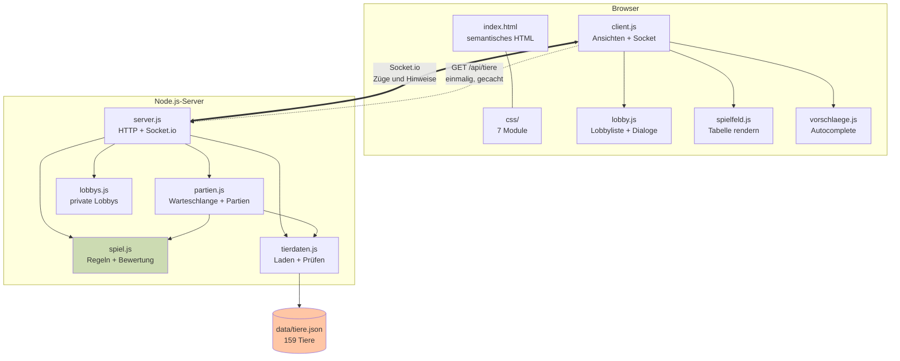
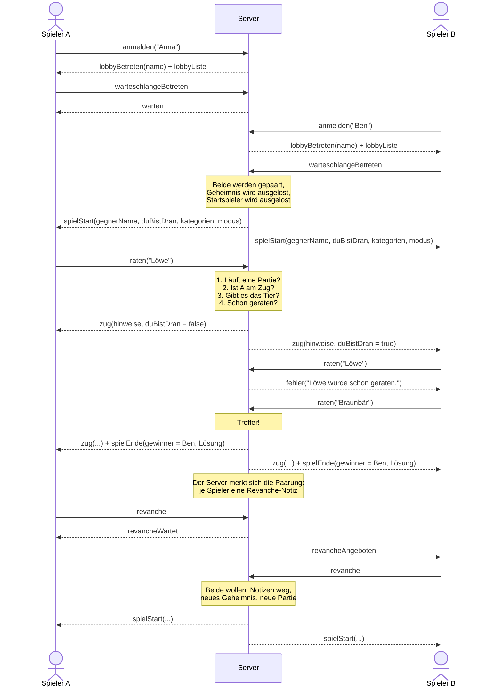
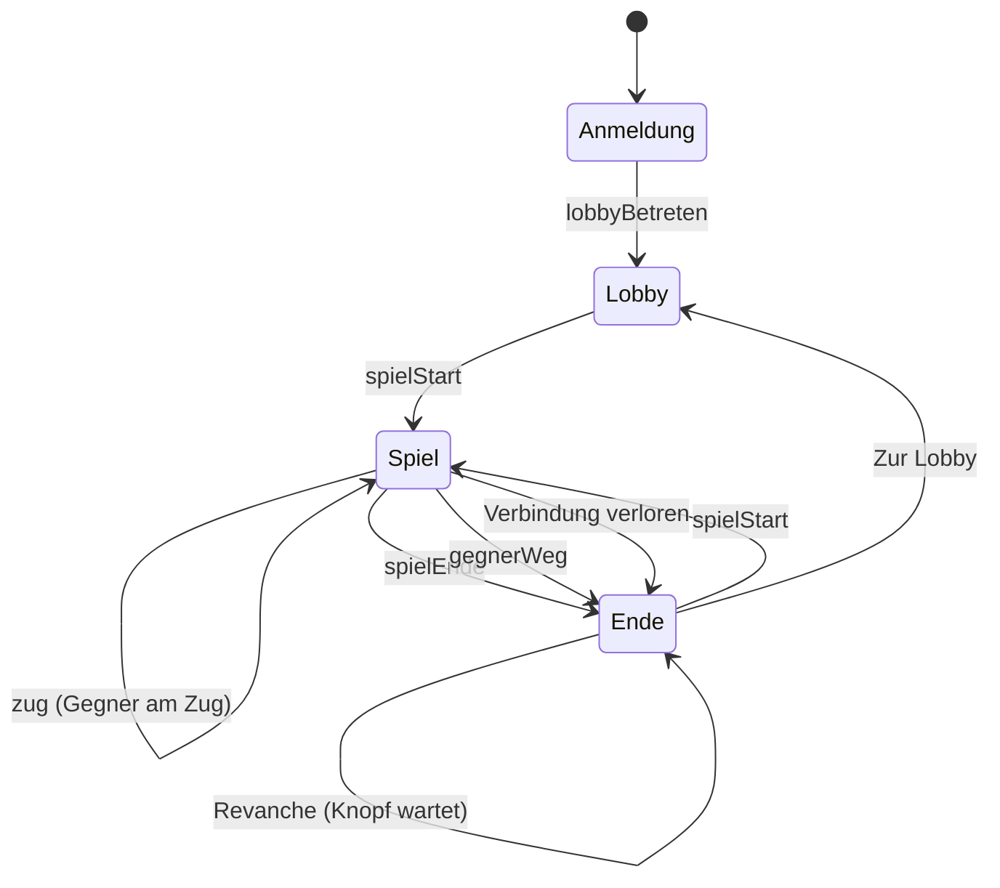
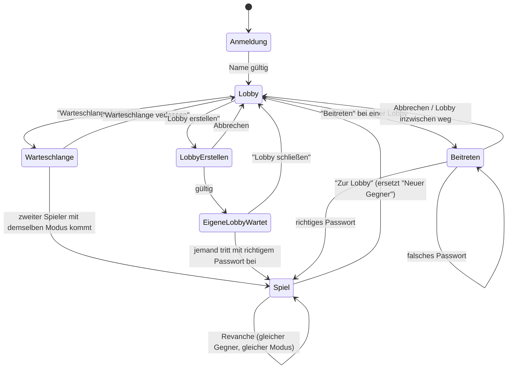

# Zoodle

Ein verteiltes Zwei-Personen-Spiel: Zwei Spieler raten abwechselnd dasselbe geheime
Tier. Jeder Tipp wird vom Server bewertet und **beiden** Spielern angezeigt. Wer das
Tier zuerst nennt, gewinnt.

Studienarbeit im Modul **W3WI_110.2 Web-Entwicklung**, DHBW Mannheim
Autor: Nico Breull

---

## Schnellstart

Ein Block, von oben nach unten kopierbar — es müssen keine Platzhalter ersetzt werden:

```bash
git clone https://github.com/Kina4You/zoodle.git
cd zoodle
npm install
npm run build
npm start -- 3000
```

Dann **http://localhost:3000** im Browser öffnen. Zum Spielen braucht es **zwei
Browserfenster** — eines davon am besten im privaten Modus, damit beide als
getrennte Spieler zählen. Nach der Anmeldung steht man in der Lobby: Klicken beide
auf **Warteschlange betreten**, startet die Partie. Alternativ eröffnet einer eine
private Lobby mit Passwort, und der andere tritt ihr bei.

Der Server gibt beim Start alle Adressen aus, unter denen er erreichbar ist,
inklusive IPv4 und IPv6:

```
  Zoodle laeuft (159 Tiere geladen)

    http://localhost:3000
    http://192.168.0.10:3000
    http://[fe80::1234:5678:9abc:def0]:3000

  Beenden mit Strg+C
```

---

## Zugang zum Code

Das Repository ist **privat**. Wer eingeladen wurde, hat drei Möglichkeiten — die
erste ist die einfachste und braucht weder Git noch eine Anmeldung an der
Kommandozeile:

**1. Als ZIP herunterladen** (empfohlen, wenn es nur ums Ansehen und Starten geht)

Auf `github.com/Kina4You/zoodle` oben rechts auf den grünen Knopf **„Code"** →
**„Download ZIP"**. Danach entpacken, in den Ordner wechseln und weiter ab
`npm install`.

**2. Mit SSH klonen** (wenn ein SSH-Schlüssel bei GitHub hinterlegt ist)

```bash
git clone git@github.com:Kina4You/zoodle.git
```

**3. Mit HTTPS klonen**

```bash
git clone https://github.com/Kina4You/zoodle.git
```

Git fragt dabei nach Benutzername und Passwort. **Das normale GitHub-Passwort
funktioniert hier nicht** — seit 2021 verlangt GitHub an dieser Stelle ein
*Personal Access Token*, das unter `github.com/settings/tokens` erzeugt wird und
als Passwort eingegeben wird. Wer das umgehen will, nimmt Weg 1 oder 2.

---

## Betrieb

### Port festlegen

Alle drei Varianten funktionieren:

```bash
npm start                 # Port 3000 (Standard)
npm start -- 8080         # Port als Argument
PORT=8080 npm start       # Port als Umgebungsvariable
```

Ein belegter Port führt nicht zu einem Absturz, sondern zu einer Meldung mit
Vorschlag für einen freien Port.

### Im Hintergrund laufen lassen

`npm start` blockiert das Terminal. Für den Dauerbetrieb:

```bash
nohup npm start -- 3000 > zoodle.log 2>&1 &
```

`nohup` sorgt dafür, dass der Server weiterläuft, wenn man das Terminal schließt
oder die SSH-Verbindung trennt. Alle Ausgaben landen in `zoodle.log`.

Nachsehen, ob er läuft — und ihn wieder beenden:

```bash
ps aux | grep "[s]erver/server.js"    # zeigt den Prozess, falls er läuft
pkill -f "[s]erver/server.js"         # beendet ihn
tail -f zoodle.log                    # Log mitlesen, Abbruch mit Strg+C
```

Die eckigen Klammern um das erste Zeichen sind kein Tippfehler: Ohne sie steht das
Suchmuster selbst in der Kommandozeile und der Befehl findet sich selbst. Bei
`pkill` ist das gefährlich — es beendet dann die eigene Shell mit.

---

## Auf einem Server betreiben

Getestet auf Ubuntu 24.04 mit dem Hochschulserver der DHBW Mannheim. Alle Schritte
laufen im Benutzerverzeichnis — **`sudo` wird nirgends gebraucht.**

### 1. Verbinden

Der DHBW-Server ist von außen nur über VPN erreichbar (Cisco Secure Client,
`drogon.dhbw-mannheim.de`). Ohne aktives VPN läuft `ssh` in einen Timeout.

```bash
ssh breull@[2001:7c0:1b20:c913:1::3d8]
```

### 2. Node.js über nvm installieren

Nur beim ersten Mal nötig. Der Node Version Manager installiert nach `~/.nvm` und
braucht keine Administratorrechte:

```bash
curl -o- https://raw.githubusercontent.com/nvm-sh/nvm/v0.40.1/install.sh | bash
source ~/.bashrc
nvm install --lts
nvm alias default lts/*
node --version        # muss v24.x zeigen
```

`source ~/.bashrc` ist wichtig: Ohne diese Zeile kennt die laufende Sitzung den
Befehl `nvm` noch nicht.

### 3. Projekt holen und prüfen

```bash
git clone https://github.com/Kina4You/zoodle.git ~/zoodle
cd ~/zoodle
npm install
npm run build
npm test
```

Alle 69 Tests müssen grün sein, bevor es weitergeht.

### 4. Starten

```bash
cd ~/zoodle
nohup npm start -- 3333 > zoodle.log 2>&1 &
```

Erreichbar ist das Spiel dann unter — **die eckigen Klammern gehören zur Adresse**,
ohne sie versteht der Browser die IPv6-Adresse nicht:

```
http://[2001:7c0:1b20:c913:1::3d8]:3333
```

### 5. Auf einen neueren Stand bringen

```bash
cd ~/zoodle
git pull
npm install
npm test
pkill -f "[s]erver/server.js"
nohup npm start -- 3333 > zoodle.log 2>&1 &
```

Bricht `git pull` mit *"Your local changes to the following files would be
overwritten"* für `package-lock.json` ab, hat `npm install` die Datei verändert.
Sie wird ohnehin erzeugt und kann verworfen werden:

```bash
git checkout -- package-lock.json
git pull
```

### Was dabei zu beachten ist

- **Ein Neustart des Servers beendet Zoodle.** `nohup` übersteht das Abmelden, aber
  keinen Reboot. Danach muss Schritt 4 erneut ausgeführt werden; einen Autostart
  über `systemd` gibt es bewusst nicht.
- **Kein HTTPS** — siehe *Bekannte Einschränkungen*.

---

## Voraussetzungen

| | |
|---|---|
| Node.js | ab Version 18 (getestet mit 22 und 24) |
| Abhängigkeiten | zum Spielen nur `express` und `socket.io`; zum Testen zusätzlich `socket.io-client` |
| Browser | Firefox, Safari, Chrome — jeweils aktuelle Version |
| Auflösung | ab 1024 × 768 Pixel |

Es gibt **keinen Übersetzungsschritt**: HTML, CSS und JavaScript laufen genau so, wie
sie im Repository liegen. `npm run build` prüft stattdessen die Syntax aller
Servermodule und die Vollständigkeit der Tierdaten — der Build schlägt also fehl,
bevor der Server mit kaputten Daten startet. Außerdem bricht er ab, sobald unter
`public/` irgendwo `!important` steht (Vorgabe des Dozenten).

Die Schriften liegen im Projekt (`public/fonts/`). Das Spiel lädt **nichts** von
fremden Servern nach und funktioniert ohne Internetverbindung.

---

## Projektstruktur

```
zoodle/
├── data/
│   └── tiere.json            159 Lebewesen mit je 7 Eigenschaften
├── server/
│   ├── server.js             HTTP + Socket.io, verdrahtet die Module
│   ├── partien.js            Warteschlange und Partieverwaltung
│   ├── lobbys.js             Private Lobbys mit Passwort, Spielmodus und Zugzeit
│   ├── zugzeit.js            Die Uhr pro Zug - läuft nur hier auf dem Server
│   ├── spiel.js              Spielregeln und Bewertungslogik
│   └── tierdaten.js          Laden und Prüfen der Tierliste
├── public/
│   ├── index.html            Semantisches HTML: Lobby, Spielfeld, Dialoge
│   ├── favicon.svg
│   ├── fonts/                Caprasimo und Figtree
│   ├── css/
│   │   ├── schriften.css     @font-face
│   │   ├── tokens.css        Farben, Schriften, Abstände
│   │   ├── basis.css         Reset, Seitenaufbau, Typografie
│   │   ├── komponenten.css   Knöpfe, Felder, Karten, Spielermarken, Dialog
│   │   ├── spielfeld.css     Tabelle, Kacheln, Vorschlagsliste
│   │   ├── lobby.css         Lobby, Lobbyliste, Lobby-Dialoge
│   │   ├── duell.css         Duell: zwei Bretter, Gefahrenstufe, Finale
│   │   └── szene.css         Lebensraum-Szene als Seitenhintergrund
│   └── js/
│       ├── client.js         Ansichtssteuerung und Socket-Kommunikation
│       ├── lobby.js          Lobbyliste, Dialoge, Passwortfelder
│       ├── spielfeld.js      Rendert die Tipp-Tabelle und die Duell-Bretter
│       ├── fortschritt.js    Duell: geknackt, Gefahrenstufe, Meilensteine (ohne DOM)
│       ├── zuguhr.js         Zeigt die Restzeit an (misst nichts)
│       └── vorschlaege.js    Eigene Autocomplete-Komponente
├── scripts/
│   ├── pruefe-daten.js       Wird von "npm run build" aufgerufen
│   └── pruefe-important.js   Build bricht ab, sobald unter public/ "!important" steht
└── tests/
    ├── server.test.js        Integrationstests gegen den echten Server
    ├── spiel.test.js         Bewertungslogik und Spielablauf
    ├── partien.test.js       Warteschlange, Partien, Revanche
    ├── lobbys.test.js        Lobbys, Passwort-Hash, Sperre, Grenzen
    ├── zugzeit.test.js       Zugzeit mit simulierter Uhr (mock.timers)
    ├── fortschritt.test.js   Fortschritt, Stufengrenzen, Meilenstein-Sätze
    ├── tierdaten.test.js     Tierdaten und Suche
    ├── vorschlaege.test.js   Reihenfolge der Vorschlagsliste
    └── important.test.js     Build-Prüfung gegen "!important"
```

---

## Architektur



Die dick gezeichnete Linie ist der Spielbetrieb, die gestrichelte der einmalige
Download der Tierliste.

**Der wichtigste Punkt:** `spiel.js` und das gesuchte Tier liegen ausschließlich auf
dem Server. Der Browser erfährt nie, welches Tier gesucht ist — er bekommt nur die
*Bewertung* seiner Tipps. Erst beim Spielende wird die Lösung mitgeschickt.

---

## Ablauf der Kommunikation



Klickt einer der beiden stattdessen **Zur Lobby**, verfällt sein Angebot und
der andere bekommt `revancheGeplatzt` – er wartet also nie vergeblich. Dasselbe
passiert, wenn er die Verbindung verliert. Beide Wege behalten den Spielernamen
und die bestehende Verbindung: Die Seite wird nicht neu geladen.

Wie eine **private Lobby** abläuft, steht im Abschnitt
[Lobby und Spielmodi](#lobby-und-spielmodi).

### Nachrichtenübersicht

**Client → Server**

| Ereignis | Nutzdaten |
|---|---|
| `anmelden` | Spielername (startet keine Partie mehr, sondern führt in die Lobby) |
| `warteschlangeBetreten` | `{ modus }` – ohne Angabe Zufallstier |
| `warteschlangeVerlassen` | – |
| `lobbyErstellen` | `{ modus, passwort, zugzeit }` – Zugzeit 10, 20, 30, 60 oder 0 (ohne Limit) |
| `lobbySchliessen` | – |
| `lobbyBeitreten` | `{ lobbyId, passwort }` |
| `tierWaehlen` | Tiername – nur im Duell: das Tier, das der **Gegner** erraten muss |
| `raten` | Tiername |
| `tippt` | **keine Daten** – Duell: „ich tippe gerade“, nie Buchstaben |
| `revanche` | – |
| `zurLobby` | – (ersetzt das frühere `neuerGegner`) |

**Server → Client**

| Ereignis | Nutzdaten |
|---|---|
| `lobbyBetreten` | `{ name }` – der Name, wie der Server ihn gespeichert hat |
| `lobbyListe` | `[{ id, erstellerName, modus, zugzeit }]` – neueste zuerst, nie mit Passwort |
| `warten` | `{ modus, zugzeit }` – man steht in der Warteschlange dieses Modus (immer 10 s) |
| `lobbyErstellt` | `{ modus, zugzeit }` |
| `erstellenAbgelehnt` | `{ grund }`: `passwort`, `modus`, `zugzeit` oder `voll` |
| `beitrittAbgelehnt` | `{ grund }`: `passwort`, `voll`, `weg` oder `gesperrt` |
| `spielStart` | `gegnerName`, `duBistDran`, `kategorien`, `modus`, `zugzeit`, `restzeitMs` |
| `tierGewaehlt` | `{ tierName }` – Duell: Bestätigung der eigenen Wahl |
| `gegnerHatGewaehlt` | – Duell: der Gegner hat gewählt (aber nicht, **was**) |
| `duellStart` | `{ duBistDran, restzeitMs }` – Duell: beide haben gewählt, das Raten beginnt |
| `zug` | `raterName`, `vonMir`, `tierName`, `hinweise`, `richtig`, `duBistDran`, `restzeitMs` |
| `zeitAbgelaufen` | `{ duBistDran, restzeitMs }` – die Zeit ist um, der Zug geht ohne Tipp an den anderen |
| `gegnerTippt` | **keine Daten** – Duell: der Gegner tippt gerade |
| `spielEnde` | `gewinnerName`, `duHastGewonnen`, `geheimnis`, `anzahlTipps` (im Duell: Tipps des Gewinners) |
| `gegnerWeg` | `geheimnis` |
| `revancheWartet` | – |
| `revancheAngeboten` | – |
| `revancheGeplatzt` | kurzer Grund (steht direkt auf dem Knopf) |
| `fehler` | Meldungstext |

`restzeitMs` ist die Restzeit des Spielers, der **jetzt** dran ist, in Millisekunden –
`null` heißt: keine Frist (ohne Zeitlimit, Duell-Wahlphase oder Partie vorbei).
Verschickt wird bewusst nie eine Uhrzeit (siehe [Zugzeit](#zugzeit)).

---

## Zustände im Browser



Die Endkarte ist keine Sackgasse: Wer dort auf **Revanche** klickt, bleibt auf ihr
stehen, bis der Server mit `spielStart` antwortet; **Zur Lobby** führt zurück in die
Lobby. Nur bei verlorener Verbindung laden die beiden Knöpfe die Seite neu – ein
`emit` über einen toten Socket käme nirgends an.

Lobby, Spielfeld und Endkarte liegen gleichzeitig im HTML und werden über das
`hidden`-Attribut ein- und ausgeblendet (`client.js`, z. B. `spielbereich.hidden
= false`). Dadurch gibt es beim Umschalten kein Nachladen und keine Wartezeit.
Lobby und Spielfeld sind zwei `<section>` in **einem** gemeinsamen `<main>`.

Die Ausnahme sind die Dialoge (Anmeldung, Lobby erstellen, Beitreten, eigene Lobby,
Warteschlange): Sie sind echte `<dialog>`-Elemente und werden mit `showModal()`
geöffnet und mit `close()` geschlossen. Abdunkeln (`::backdrop`), Zentrieren und das
Sperren der Seite dahinter übernimmt der Browser. Bei der Anmeldung und in den beiden
Wartedialogen darf Esc nicht schließen. Das `cancel`-Ereignis wird abgefangen, und
weil Chrome sich das ohne vorherigen Klick nicht verbieten lässt, öffnet sich der
Dialog sofort wieder, falls er sich trotzdem schließt (`haltOffen` in `lobby.js`).

Bewusst das Attribut und keine eigene CSS-Klasse: `hidden` ist Teil von HTML,
Screenreader respektieren es von sich aus. Damit eine Klasse wie `.karte` mit
`display: flex` es nicht versehentlich übersteuert, liegt die Regel
`[hidden] { display: none; }` in der Kaskadenebene `zustand`. Jede CSS-Datei steckt
in ihrer eigenen Ebene (`@layer`), die Reihenfolge steht am Anfang von
`schriften.css`: `schriften, tokens, basis, komponenten, spielfeld, lobby, duell, szene, zustand`.
Eine spätere Ebene gewinnt immer, egal wie spezifisch der Selektor der früheren
ist. `zustand` steht ganz hinten, deshalb setzt sich `[hidden]` durch.

Animationen und Übergänge stehen ausschließlich in
`@media (prefers-reduced-motion: no-preference) { … }`. Wer im Betriebssystem
„Bewegung reduzieren“ eingestellt hat, bekommt sie also gar nicht erst, und es muss
nichts überschrieben werden.

---

## Lobby und Spielmodi

Nach der Anmeldung steht man in der **Lobby** und wählt einen von drei Wegen ins Spiel:

- **Schnell spielen** – öffentliche Warteschlange mit Moduswahl. Jeder Modus hat
  seine **eigene** Warteschlange: Der Server paart die ersten beiden Wartenden, die
  denselben Modus gewählt haben.
- **Eigene Lobby** – privat, mit Passwort und frei wählbarem Modus. Die Lobby erscheint
  sofort in der Liste aller, die gerade in der Lobby stehen.
- **Beitreten** – einer privaten Lobby aus der Liste, mit dem Passwort vom Ersteller.



**Die Lobbyliste ist live.** Wer frei in der Lobby steht, ist auf dem Server im
Socket.io-**Raum** `lobby`. Ändert sich die Liste – neue Lobby, besetzt, geschlossen,
Ersteller weg –, schickt der Server `lobbyListe` per `io.to('lobby').emit(...)` an
genau diese Spieler. Wer wartet oder spielt, ist nicht im Raum; deshalb steht die
eigene Lobby nie in der eigenen Liste.

**Viele Lobbys, kleine Bildschirme.** Geprüft mit 50 offenen Lobbys (der Obergrenze)
bei 1280, 1024, 768 und 390 Pixel Breite:

- Die Liste scrollt in sich – höchstens `min(60vh, 32rem)` hoch. Überschrift, Anzahl
  und Fußzeile bleiben sichtbar; die Seite ist auf dem Desktop 1,2 statt 4,7
  Bildschirme hoch.
- **Suche** nach dem Namen des Erstellers und **Filter** nach Modus (Alle /
  Zufallstier / Duell), beides im Browser. Die Anzahl zeigt dann „2 von 50 offen“,
  Screenreader hören nach einer kurzen Tipp-Pause, wie viele Lobbys passen.
- Unter 900 px stehen die Wege über der Liste, unter 560 px bricht ein Eintrag in zwei
  Zeilen um. Lange Namen brechen um, statt abgeschnitten zu werden. Bei keiner der vier
  Breiten scrollt die Seite waagerecht.
- Stolperstein: Die unsichtbaren `.nur-sr`-Texte sind `position: absolute`. Jeder
  Scrollbereich, der sie enthält (Lobbyliste, Tabelle), braucht `position: relative`
  – sonst beziehen sie sich auf die ganze Seite, werden nicht abgeschnitten und machen
  sie unsichtbar länger oder breiter.

**Regeln, die der Server durchsetzt** (`server/lobbys.js`, ohne Socket.io testbar):

| Regel | Umsetzung |
|---|---|
| Passwort 4 bis 32 Zeichen | geprüft beim Erstellen; der Browser prüft vorher nur aus Komfort |
| Passwort nie im Klartext | `scryptSync` mit 16 Byte Salz aus `node:crypto`, Vergleich mit `timingSafeEqual` |
| Liste ohne Geheimnisse | an Clients gehen nur `id`, `erstellerName`, `modus` |
| 5 falsche Passwörter | 30 Sekunden Sperre – je Spieler und je Lobby, auch für das richtige Passwort |
| Zwei treten gleichzeitig bei | Die Prüfung läuft ohne `await` in einem Stück; der Erste gewinnt, der Zweite bekommt `voll` |
| Höchstens eine Lobby pro Spieler, 50 insgesamt | sonst `erstellenAbgelehnt` |
| Niemand wartet an zwei Orten | `pruefeFrei()` in `server.js`: nicht in Partie, Warteschlange oder eigener Lobby |
| Ende einer Lobby | mit dem Spielende, mit „Lobby schließen“ oder wenn der Ersteller die Verbindung verliert |

**Spielmodi.** Jede Partie (`Spiel` in `spiel.js`) hat ein Feld `modus`, und
`spielStart` schickt es mit. Eine Revanche behält den Modus.

- **Zufallstier** – das bisherige Spiel: Der Server lost ein Tier aus, beide raten
  darauf.
- **Duell** – beim schnellen Spiel und in privaten Lobbys. Die Partie beginnt mit der **Wahl**: Jeder
  sucht über das gewohnte Eingabefeld ein Tier für den anderen aus (`tierWaehlen`).
  Haben beide gewählt (`duellStart`), wird abwechselnd geraten – jeder auf das Tier,
  das der andere für ihn gewählt hat. Wer zuerst richtig liegt, gewinnt.

Was im Duell anders ist und warum:

| Regel | Grund |
|---|---|
| Vor der Wahl darf niemand raten | Es gibt noch kein Tier, gegen das bewertet werden könnte. |
| Die Wahl bleibt bis zum Spielende geheim | Der Gegner bekommt nur `gegnerHatGewaehlt`, nie den Tiernamen – wie beim Zufallstier verlässt das gesuchte Tier den Server erst am Ende. |
| „Schon geraten“ zählt nur die eigenen Tipps | Was der Gegner geraten hat, kann genau das Tier sein, das ich suche. |
| Beide sehen alle Tipps | Jede Zeile ist mit „Du“ oder dem Gegnernamen beschriftet; ihre Hinweise beziehen sich auf das Tier, das **dieser** Spieler sucht. |
| `spielEnde` und `gegnerWeg` verraten jedem sein eigenes Tier | Der Verlierer erfährt, was er gesucht hat. |

Im Code: `Spiel` (`spiel.js`) hat dafür `phase` (`'wahl'` / `'raten'`), `ziele`
(Spieler → zu erratendes Tier), `waehleTier()` und `geheimnisVon()`. Die Prüfung in
`behandleTierwahl()` (`server.js`) läuft wie das Raten ohne `await`.

**Barrierefreiheit.**

- Die Lobbyliste ist eine `<ul>`. Jeder „Beitreten“-Knopf trägt einen vollen Namen
  für Screenreader („Beitreten – Lobby von Lena, Modus Zufallstier“); der sichtbare
  Text steht vorne, damit Sprachsteuerung ihn findet.
- Der Modus ist ein `<fieldset>` mit echten Radio-Knöpfen.
- Passwortfelder haben ein sichtbares Label. Hinweis und Fehler hängen über
  `aria-describedby` am Feld, der Fehler zusätzlich mit `aria-invalid="true"`.
- **Ansagen in Dialogen:** Solange ein modaler Dialog offen ist, sperrt der Browser
  alles außerhalb für Screenreader – auch die Region `#ansage`. Jeder Dialog hat
  deshalb eine eigene, leere Ansage-Region, und `sage()` schreibt automatisch in die
  des offenen Dialogs.
- **Fokus:** Nach dem Schließen eines Dialogs kehrt er zum Knopf zurück, der ihn
  geöffnet hat. Verschwindet die Lobby, deren Knopf gerade fokussiert ist, springt er
  auf die Überschrift „Private Lobbys“. Ist sie weg, während ihr Dialog offen ist,
  bleibt nur „Abbrechen“ aktiv.

---

## Zugzeit

Jeder Zug hat eine Frist: **öffentlich immer 10 Sekunden**, in einer privaten Lobby
wählbar (10, 20, 30, 60 Sekunden oder **ohne Zeitlimit**). Läuft sie ab, geht der Zug
**ohne Tipp** an den anderen. Im Duell gibt es während der Wahl keine Frist.

**Warum die Uhr nur auf dem Server läuft.** Würde der Browser die Zeit messen, könnte
ein Spieler sie einfach anhalten – mit den Entwicklerwerkzeugen oder einer verstellten
Rechneruhr – und beliebig lange nachdenken. Deshalb gilt wie bei allen Spielregeln:
**Der Server entscheidet, der Browser zeigt nur an.**

- `server/zugzeit.js` (ohne Socket.io) startet bei jedem Zugwechsel eine Frist pro
  Partie. Läuft sie ab, gibt `server.js` den Zug weiter und schickt `zeitAbgelaufen`.
- Ein Tipp, der nach dem Fristende eintrifft, aber bevor Node den Ablauf bearbeitet
  hat, wird abgelehnt („Deine Zeit ist abgelaufen.“).
- Aufgeräumt wird bei Spielende und Trennung; eine Revanche übernimmt die Zugzeit.
- Der Server verschickt nur die **Restzeit** (`restzeitMs`), nie eine Uhrzeit. Die Uhren
  von Server und Browser gehen nie genau gleich – eine Restzeit bleibt auch dann
  richtig, wenn der Rechner des Spielers falsch eingestellt ist.

**Im Browser** zählt `public/js/zuguhr.js` die Restzeit nur für die Anzeige herunter:
Zahl (immer sichtbar), Balken und Farbe – grün, ab 5 Sekunden orange, ab 3 Sekunden
dunkles Rotbraun mit kurzem Wackeln (nur bei `no-preference`, höchstens 3 Sekunden).
Beide sehen die Uhr („Deine Zeit“ bzw. „Zeit von Lena“), im Duell steht sie zusätzlich
im Brett des Gegners, wenn er dran ist. Die Uhr hat `role="timer"`: Der Screenreader
liest den Sekundentakt nicht vor. Angesagt werden nur „Noch 5 Sekunden.“ (für den,
der dran ist) und der Zugwechsel beim Ablauf.

**Tests ohne Warten:** `tests/zugzeit.test.js` simuliert Zeitgeber und Uhr mit
`mock.timers` aus `node:test`. Für die Integrationstests startet ein zweiter Server mit
`ZUGZEIT_MS_PRO_SEKUNDE=50` – dort dauern 10 Sekunden nur eine halbe. Ohne diese
Umgebungsvariable hat sie keine Wirkung.

---

## Duell: zwei Bretter und Live-Druck

In der Ratephase eines Duells sieht jeder **zwei Bretter** untereinander:

- **Oben „Lenas Brett“** (Gegner), kompakt: Fortschritt („5 von 7 geknackt“),
  **Gefahrenstufe**, „Lena tippt …“, **Meilenstein** und eine Spurkarte pro Tipp
  (Tiername + sieben Bewertungen ✓ ~ ✕, ohne Werte).
- **Darunter „Dein Brett“**: die gewohnte große Tabelle, aber nur mit den eigenen
  Tipps („Tipp 4“ statt Spielername). `client.js` hängt dafür dasselbe `<table>`-Element
  um – es gibt nur eine Tabelle und nur einen Code, der sie füllt.
- **Untereinander, nicht nebeneinander:** Die Tabelle braucht rund 900 px. Nebeneinander
  wäre das Spiel bei 1024 × 768 nicht ohne waagerechtes Scrollen spielbar.

**Fortschritt und Gefahrenstufe.** Eine Eigenschaft ist *geknackt*, sobald sie in
irgendeinem Tipp stimmte. 0–2 geknackt: kalt · 3–4: warm · 5–6: **heiß** (Rahmen am Brett)
· 7: **kurz vorm Ziel!** – immer Wort + Thermometer + Farbe. Ab „heiß“ schlägt das Brett
nach jedem Zug des Gegners drei Herzschläge (gut 2 Sekunden, dann Ruhe – WCAG 2.2.2
verbietet Dauerbewegung über 5 Sekunden). Bei „Bewegung reduzieren“ gibt es keinen
Herzschlag; Rahmen und Wort bleiben.

**Meilensteine.** Knackt der Gegner etwas Neues, steht im Brett z. B. „Neu: Lena hat die
Aktivitätszeit geknackt – jetzt 5 von 7! Lena ist jetzt heiß.“ – und der Satz hängt an
der Zug-Ansage für Screenreader (keine zweite Live-Region). Eigene Meilensteine gibt es
bewusst nicht: Der Druck kommt vom Gegner.

**Warum der Fortschritt im Browser berechnet wird.** Beide Browser bekommen die
Bewertungen aller Tipps ohnehin mit `zug`. Der Fortschritt ist nur eine andere
**Darstellung** dieser Daten – es entsteht keine neue Information, also auch nichts,
womit sich schummeln ließe. Die Berechnung steht in `public/js/fortschritt.js` als reine
Funktionen ohne DOM-Zugriff und ist deshalb mit `node:test` getestet.

**„Lena tippt …“** ist das einzige neue Server-Feature: Der Browser sendet beim Tippen
`tippt` (ohne Daten, höchstens alle 1,5 s, nur wenn er im Duell dran ist). Der Server
leitet es als `gegnerTippt` weiter – nur wenn die Partie läuft, im Duell, in der
Ratephase und wenn der Sender am Zug ist, höchstens einmal pro Sekunde. Sonst
passiert stillschweigend nichts. Was ein Client mitschickt, liest der Server nie; so
kann kein Buchstabe beim Gegner ankommen. Die Anzeige verschwindet nach 3 Sekunden
ohne neues Signal und wird nicht vorgelesen.

**Großes Finale.** Am Ende zeigt die Endkarte, in wie vielen Tipps gewonnen wurde und
wie viele Eigenschaften dem Verlierer fehlten. Darunter der **Endstand**: beide gesuchten
Tiere aufgedeckt (das eigene kommt mit `spielEnde`, das des Gegners hat man selbst
gewählt), Tipps und „n von 7“, der Sieger hervorgehoben. Das Fazit sagt „Knapp! Lena war
schon heiß – es fehlten nur noch Gewicht und Größe.“ oder „Klarer Sieg – …“. Beide Bretter
bleiben darunter stehen, die Untertitel in der Vergangenheit. Eine Revanche setzt alles
zurück.

**Behobener Fehler:** `anzahlTipps` in `spielEnde` zählte im Duell die Tipps **beider**
Spieler. Jetzt zählt es im Duell nur die des Gewinners.

---

## Spielregeln und Bewertung

Jeder Tipp wird in **sieben Kategorien** bewertet:

| Kategorie | Art | „nah dran“ bedeutet |
|---|---|---|
| Klasse | Text | gleiche Verwandtschaftsgruppe |
| Lebensraum | Text | gleiche Lebensraumgruppe |
| Ernährung | Text | einer von beiden ist „Allesfresser“ |
| Gewicht | Zahl | Verhältnis zwischen 0,4 und 2,5 |
| Größe | Zahl | Verhältnis zwischen 0,4 und 2,5 |
| Alter | Zahl | Verhältnis zwischen 0,4 und 2,5 |
| Aktiv | Text | einer von beiden ist „dämmerungsaktiv“ |

Zahlen gelten als **Treffer**, wenn sie höchstens 10 % abweichen. Bei einem Treffer
wird bewusst **kein** Pfeil angezeigt — eine grüne Kachel mit Richtungspfeil wäre
widersprüchlich.

Die Verwandtschaftsgruppen stehen als `GRUPPEN` in `server/spiel.js`:

- **Klasse:** [Säugetier, Vogel] · [Reptil, Amphibie, Fisch] · [Insekt, Weichtier, Krebstier, Spinnentier]
- **Lebensraum:** [Ozean, Süßwasser] · [Savanne, Wüste, Grasland] · [Wald, Regenwald] · [Gebirge, Polargebiet, Siedlung]

---

## Entwurfsentscheidungen

**Die Spielregeln stehen auf dem Server, nicht im Browser.**
Der Client sperrt zwar das Eingabefeld, wenn der Gegner am Zug ist — das ist aber nur
Komfort für ehrliche Spieler. Ein manipulierter Client könnte die Sperre umgehen.
Deshalb prüft `server.js` bei **jedem** Rateversuch erneut alle vier Bedingungen.

**Die Tierliste kommt per HTTP, die Züge per Socket.io.**
Die rund 20 KB Tierdaten ändern sich während einer Sitzung nicht. Als normaler
HTTP-Aufruf landen sie im Browser-Cache und werden nicht bei jeder Partie erneut
übertragen. Die Daten sind kein Geheimnis: *welche* Tiere es gibt, ist öffentliches
Spielwissen — geheim ist nur, *welches* gesucht wird.

**Eine echte `<table>` statt Grid-Divs.**
Die Tipp-Übersicht ist tabellarische Daten, also ist `<table>` mit `<th scope="col">`
das richtige Element. Das Aussehen entsteht über CSS.

**Farbe ist nie die einzige Information.**
Jede Hinweiskachel trägt zusätzlich ein Symbol (✓ ~ ✕), bei Zahlen dazu einen Pfeil (↑ ↓), sowie
einen unsichtbaren Klartext für Screenreader („– falsch, gesucht ist höher“, Klasse
`nur-sr`). Ein `aria-label` am `<div>` wäre dafür ungeeignet: Auf Elementen ohne eigene
Rolle ist es nicht erlaubt und wird oft ignoriert. Damit ist das Spiel auch für
Menschen mit Farbfehlsichtigkeit lesbar.

**Ansagen für Screenreader über eine einzige Live-Region.**
In `index.html` steht von Anfang an ein leeres `<p id="ansage" role="status"
aria-live="polite">`. `sage(text)` in `client.js` füllt es: bei jedem Tipp (Tier und
alle Bewertungen in ganzen Sätzen), beim Zugwechsel, beim Spielende, beim
Revanche-Angebot und wenn der Gegner weg ist. Die Region wird vorher kurz geleert,
sonst würde derselbe Satz zweimal hintereinander nicht noch einmal vorgelesen.

**Eigene Autocomplete statt `<datalist>`.**
Nur so lassen sich bereits geratene Tiere ausblenden, Kategorien durchsuchen
(„Säugetier“ → alle 87) und Pfeiltasten unterstützen. Gebaut nach dem
Combobox-Muster des W3C: Der Fokus bleibt immer im Eingabefeld, `aria-activedescendant`
zeigt dem Screenreader die markierte Option, und die Optionen sind nicht per Tab
erreichbar (`tabindex="-1"`).

**Der Server stürzt nicht ab.**
`uncaughtException` und `unhandledRejection` werden abgefangen und protokolliert.
Ein Verbindungsabbruch beendet nur die betroffene Partie — alle anderen laufen weiter.

---

## Sicherheit

Zoodle hat bewusst eine kleine Angriffsfläche: **keine Accounts, keine Konto-Passwörter,
keine Datenbank, keine Cookies, keine Sessions, keine Datei-Uploads.** Ein Großteil
der üblichen Web-Schwachstellen ist damit gegenstandslos — SQL-Injection braucht eine
Datenbank, Session Fixation eine Session.

Was aktiv abgesichert ist:

| Risiko | Maßnahme |
|---|---|
| **Cheating** (Zug erzwingen, erfundene Tiere) | Vier serverseitige Prüfungen bei jedem Zug. Die Sperre im Browser ist nur Komfort. |
| **Lösung auslesen** | Das geheime Tier verlässt den Server erst beim Spielende. Im Duell gilt das auch für die Wahl des Gegners: Er erfährt nur, *dass* gewählt wurde. |
| **Zeit anhalten** | Die Zugzeit misst nur der Server; der Browser zeigt sie an. Ein Tipp nach Fristende wird abgelehnt. |
| **Text über „tippt“ schmuggeln** | `tippt` und `gegnerTippt` haben keine Daten; was ein Client mitschickt, liest der Server nicht. Weitergeleitet wird nur für den Spieler am Zug, höchstens einmal pro Sekunde. |
| **Fremde Partien manipulieren** (IDOR) | Der Client sendet nie eine Spiel- oder Spieler-ID. Der Server leitet die Partie aus der Socket-Kennung ab, die niemand wählen kann. |
| **Cross-Site Scripting** | Im gesamten Projekt kein `innerHTML` — alle Anzeigen laufen über `textContent`. Ein Spielername `` erscheint als Text. |
| **Race Conditions** | Die Zugverarbeitung ist vollständig synchron (kein `await`). Zwei gleichzeitige Klicks können sich in Nodes Ereignisschleife nicht verschränken. |
| **Bots / Überlastung** | Höchstens 10 Nachrichten pro Sekunde und Verbindung; ab 50 wird getrennt. Die Bremse hängt als `socket.use()` vor allen Handlern und erfasst dadurch **jedes** eingehende Ereignis, auch frei erfundene Namen. Eingehende Nachrichten sind auf 8 KB begrenzt. |
| **Informationslecks** | Eigene 404- und Fehlerbehandlung: Details landen im Serverlog, der Browser bekommt nur eine knappe Meldung. |
| **Massenzuweisung** | `anmelden` und `raten` nehmen einen String. `lobbyErstellen` und `lobbyBeitreten` nehmen ein Objekt, aus dem der Server nur die erwarteten Felder liest (`modus`, `passwort`, `lobbyId`) und jedes einzeln prüft. Was keine Objekt-Nutzlast ist, gilt als leer. |
| **Lobby-Passwort** | Gespeichert nur als `scrypt`-Hash mit eigenem Salz, verglichen mit `timingSafeEqual`. Es steht in keinem Log und geht nie an einen Client. |
| **Passwort raten** (Brute Force) | 5 Fehlversuche je Spieler und Lobby, dann 30 Sekunden Sperre – zusätzlich zur Nachrichtenbremse. |
| **Speicher füllen** | Höchstens eine Lobby pro Spieler, höchstens 50 insgesamt. |
| **Verwundbare Abhängigkeiten** | Im Spielbetrieb nur `express` und `socket.io`; `socket.io-client` ist eine reine Test-Abhängigkeit und wird nie ausgeliefert. `npm audit` meldet 0 Schwachstellen. |

### Bekannte Einschränkungen

**Kein HTTPS.** Der bereitgestellte DHBW-Server unterstützt nur `http`. Die Verbindung
ist also unverschlüsselt. Mitlesbar sind Spielernamen, Spielzüge – und das
**Lobby-Passwort**: Es reist im Klartext zum Server und wird erst dort gehasht. Es ist
deshalb ausdrücklich ein **Spielpasswort**, kein Schutz für echte Geheimnisse. Der
Dialog sagt das auch: „Nimm kein Passwort, das du woanders benutzt.“

**Keine Obergrenze für Verbindungen.** Ein Test mit 300 gleichzeitigen Verbindungen
wurde vollständig angenommen; der Server blieb dabei stabil und antwortete weiter.
Die Nachrichtenbremse schützt eine *bestehende* Verbindung, nicht gegen viele *neue*.
Bewusst so belassen: Ein Limit müsste eine feste Zahl festlegen, und ein zu niedriger
Wert würde am Vorführtag stören, wenn ein ganzer Kurs gleichzeitig verbindet. Für den
vorgesehenen Einsatz — zwei Spieler an einem Hochschulserver — ist das vertretbar.

---

## Tests

```bash
npm test
```

229 Tests mit dem in Node eingebauten Test-Runner (`node:test`). Geprüft werden:

- die Bewertungslogik (Treffer, „nah dran“, Pfeilrichtung, Formatierung)
- der Spielablauf (Zugwechsel, Siegerkennung, Doppeltipps)
- die Partieverwaltung (Warteschlange, Verbindungsabbruch, mehrere Partien, Modus)
- die Lobbyverwaltung (Passwort-Hash, Sperre nach 5 Fehlversuchen mit einer Testuhr,
  Grenzen, nur erlaubte Modi, Liste ohne Geheimnisse)
- das Duell (Wahl-Phase, Bewertung gegen das eigene Tier, „schon geraten“ je Spieler,
  Geheimhaltung der Wahl, Revanche, „tippt“, `anzahlTipps` des Gewinners)
- die Zugzeit (Ablauf, rechtzeitiger und zu später Tipp, ohne Limit, Aufräumen –
  mit simulierter Uhr) und der Duell-Fortschritt (alle Stufengrenzen, Meilenstein-Sätze)
- die Tierdaten (Vollständigkeit, keine Duplikate, gültige Kategoriewerte)

### Integrationstests

`tests/server.test.js` prüft zusätzlich den **echten Server**: Er wird als eigener
Prozess auf einem freien Port gestartet, und die Tests sprechen ihn als richtige
Socket.io-Clients an — also genau so, wie es ein Browser tut. Nur so lässt sich
`server.js` testen, denn dort steht kein berechenbares Ergebnis, sondern
Kommunikation.

Abgedeckt sind Lobby und Warteschlange, private Lobbys mit falschem und richtigem
Passwort, ein komplettes Duell, gleichzeitiges Beitreten, Trennung des Erstellers, **alle vier
Regelprüfungen gegen Cheating**, Zugwechsel, Sieg, Verbindungsabbruch in jeder
Spielphase, kaputte Nutzlasten und gleichzeitige Züge. Ein eigener Test spielt eine Partie und durchsucht **jede** an die Clients
gesendete Nachricht nach dem Namen des gesuchten Tieres — der Nachweis, dass die
Lösung den Server nicht vorzeitig verlässt.

Dafür wird `socket.io-client` als **devDependency** gebraucht. Sie ist ausschließlich
für die Tests da und wird beim Spielen nie geladen.

Dass die Tests echtes Verhalten prüfen und nicht bloß, dass nichts abstürzt, lässt
sich zeigen: Entfernt man in `server.js` die Prüfung „ist dieser Spieler am Zug?",
schlagen sofort vier Tests fehl.
